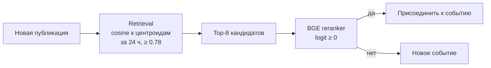
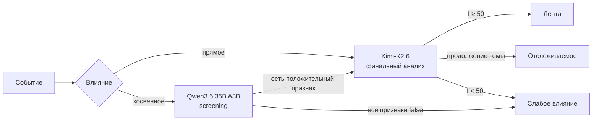
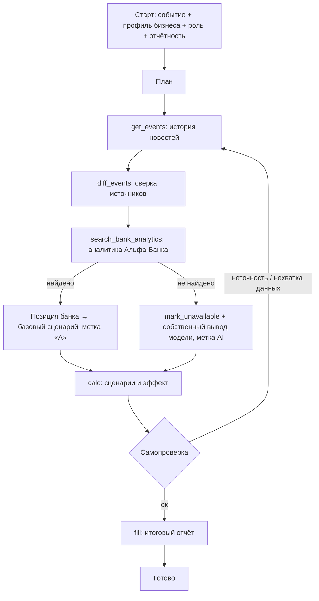

<svg xmlns="http://www.w3.org/2000/svg" width="1437" height="349" viewBox="0 0 1437 349">
<defs><linearGradient id="scan" x1="0" y1="0" x2="0" y2="1"><stop offset="0" stop-color="#e8231f" stop-opacity="0"/><stop offset="0.85" stop-color="#e8231f" stop-opacity="0.3"/><stop offset="1" stop-color="#e8231f" stop-opacity="0.85"/></linearGradient><clipPath id="lc"><rect x="48" y="48" width="253" height="221"/></clipPath></defs>
<rect x="1" y="1" width="1435" height="347" rx="24" fill="#ffffff" stroke="#e6e6e6" stroke-width="2"/>
<rect x="48" y="48" width="13" height="13" rx="3.5" fill="#f1f1f1"/>
<rect x="64" y="48" width="13" height="13" rx="3.5" fill="#f1f1f1"/>
<rect x="80" y="48" width="13" height="13" rx="3.5" fill="#f1f1f1"/>
<rect x="96" y="48" width="13" height="13" rx="3.5" fill="#f1f1f1"/>
<rect x="112" y="48" width="13" height="13" rx="3.5" fill="#f1f1f1"/>
<rect x="128" y="48" width="13" height="13" rx="3.5" fill="#f1f1f1"/>
<rect x="144" y="48" width="13" height="13" rx="3.5" fill="#f1f1f1"/>
<rect x="160" y="48" width="13" height="13" rx="3.5" fill="#2f2f2f"/>
<rect x="176" y="48" width="13" height="13" rx="3.5" fill="#2f2f2f"/>
<rect x="192" y="48" width="13" height="13" rx="3.5" fill="#f1f1f1"/>
<rect x="208" y="48" width="13" height="13" rx="3.5" fill="#f1f1f1"/>
<rect x="224" y="48" width="13" height="13" rx="3.5" fill="#f1f1f1"/>
<rect x="240" y="48" width="13" height="13" rx="3.5" fill="#f1f1f1"/>
<rect x="256" y="48" width="13" height="13" rx="3.5" fill="#f1f1f1"/>
<rect x="272" y="48" width="13" height="13" rx="3.5" fill="#f1f1f1"/>
<rect x="288" y="48" width="13" height="13" rx="3.5" fill="#f1f1f1"/>
<rect x="304" y="48" width="13" height="13" rx="3.5" fill="#f1f1f1"/>
<rect x="320" y="48" width="13" height="13" rx="3.5" fill="#f1f1f1"/>
<rect x="336" y="48" width="13" height="13" rx="3.5" fill="#f1f1f1"/>
<rect x="352" y="48" width="13" height="13" rx="3.5" fill="#f1f1f1"/>
<rect x="368" y="48" width="13" height="13" rx="3.5" fill="#f1f1f1"/>
<rect x="384" y="48" width="13" height="13" rx="3.5" fill="#f1f1f1"/>
<rect x="400" y="48" width="13" height="13" rx="3.5" fill="#f1f1f1"/>
<rect x="416" y="48" width="13" height="13" rx="3.5" fill="#f1f1f1"/>
<rect x="432" y="48" width="13" height="13" rx="3.5" fill="#f1f1f1"/>
<rect x="448" y="48" width="13" height="13" rx="3.5" fill="#f1f1f1"/>
<rect x="464" y="48" width="13" height="13" rx="3.5" fill="#f1f1f1"/>
<rect x="480" y="48" width="13" height="13" rx="3.5" fill="#f1f1f1"/>
<rect x="496" y="48" width="13" height="13" rx="3.5" fill="#f1f1f1"/>
<rect x="512" y="48" width="13" height="13" rx="3.5" fill="#f1f1f1"/>
<rect x="528" y="48" width="13" height="13" rx="3.5" fill="#f1f1f1"/>
<rect x="544" y="48" width="13" height="13" rx="3.5" fill="#f1f1f1"/>
<rect x="560" y="48" width="13" height="13" rx="3.5" fill="#f1f1f1"/>
<rect x="576" y="48" width="13" height="13" rx="3.5" fill="#f1f1f1"/>
<rect x="592" y="48" width="13" height="13" rx="3.5" fill="#f1f1f1"/>
<rect x="608" y="48" width="13" height="13" rx="3.5" fill="#f1f1f1"/>
<rect x="624" y="48" width="13" height="13" rx="3.5" fill="#f1f1f1"/>
<rect x="640" y="48" width="13" height="13" rx="3.5" fill="#f1f1f1"/>
<rect x="656" y="48" width="13" height="13" rx="3.5" fill="#f1f1f1"/>
<rect x="672" y="48" width="13" height="13" rx="3.5" fill="#f1f1f1"/>
<rect x="688" y="48" width="13" height="13" rx="3.5" fill="#f1f1f1"/>
<rect x="704" y="48" width="13" height="13" rx="3.5" fill="#f1f1f1"/>
<rect x="720" y="48" width="13" height="13" rx="3.5" fill="#f1f1f1"/>
<rect x="736" y="48" width="13" height="13" rx="3.5" fill="#f1f1f1"/>
<rect x="752" y="48" width="13" height="13" rx="3.5" fill="#f1f1f1"/>
<rect x="768" y="48" width="13" height="13" rx="3.5" fill="#f1f1f1"/>
<rect x="784" y="48" width="13" height="13" rx="3.5" fill="#f1f1f1"/>
<rect x="800" y="48" width="13" height="13" rx="3.5" fill="#f1f1f1"/>
<rect x="816" y="48" width="13" height="13" rx="3.5" fill="#f1f1f1"/>
<rect x="832" y="48" width="13" height="13" rx="3.5" fill="#f1f1f1"/>
<rect x="848" y="48" width="13" height="13" rx="3.5" fill="#f1f1f1"/>
<rect x="864" y="48" width="13" height="13" rx="3.5" fill="#f1f1f1"/>
<rect x="880" y="48" width="13" height="13" rx="3.5" fill="#f1f1f1"/>
<rect x="896" y="48" width="13" height="13" rx="3.5" fill="#f1f1f1"/>
<rect x="912" y="48" width="13" height="13" rx="3.5" fill="#f1f1f1"/>
<rect x="928" y="48" width="13" height="13" rx="3.5" fill="#f1f1f1"/>
<rect x="944" y="48" width="13" height="13" rx="3.5" fill="#f1f1f1"/>
<rect x="960" y="48" width="13" height="13" rx="3.5" fill="#f1f1f1"/>
<rect x="976" y="48" width="13" height="13" rx="3.5" fill="#f1f1f1"/>
<rect x="992" y="48" width="13" height="13" rx="3.5" fill="#f1f1f1"/>
<rect x="1008" y="48" width="13" height="13" rx="3.5" fill="#f1f1f1"/>
<rect x="1024" y="48" width="13" height="13" rx="3.5" fill="#f1f1f1"/>
<rect x="1040" y="48" width="13" height="13" rx="3.5" fill="#f1f1f1"/>
<rect x="1056" y="48" width="13" height="13" rx="3.5" fill="#f1f1f1"/>
<rect x="1072" y="48" width="13" height="13" rx="3.5" fill="#f1f1f1"/>
<rect x="1088" y="48" width="13" height="13" rx="3.5" fill="#f1f1f1"/>
<rect x="1104" y="48" width="13" height="13" rx="3.5" fill="#f1f1f1"/>
<rect x="1120" y="48" width="13" height="13" rx="3.5" fill="#f1f1f1"/>
<rect x="1136" y="48" width="13" height="13" rx="3.5" fill="#f1f1f1"/>
<rect x="1152" y="48" width="13" height="13" rx="3.5" fill="#f1f1f1"/>
<rect x="1168" y="48" width="13" height="13" rx="3.5" fill="#f1f1f1"/>
<rect x="1184" y="48" width="13" height="13" rx="3.5" fill="#f1f1f1"/>
<rect x="1200" y="48" width="13" height="13" rx="3.5" fill="#f1f1f1"/>
<rect x="1216" y="48" width="13" height="13" rx="3.5" fill="#f1f1f1"/>
<rect x="1232" y="48" width="13" height="13" rx="3.5" fill="#f1f1f1"/>
<rect x="1248" y="48" width="13" height="13" rx="3.5" fill="#f1f1f1"/>
<rect x="1264" y="48" width="13" height="13" rx="3.5" fill="#f1f1f1"/>
<rect x="1280" y="48" width="13" height="13" rx="3.5" fill="#f1f1f1"/>
<rect x="1296" y="48" width="13" height="13" rx="3.5" fill="#f1f1f1"/>
<rect x="1312" y="48" width="13" height="13" rx="3.5" fill="#f1f1f1"/>
<rect x="1328" y="48" width="13" height="13" rx="3.5" fill="#f1f1f1"/>
<rect x="1344" y="48" width="13" height="13" rx="3.5" fill="#f1f1f1"/>
<rect x="1360" y="48" width="13" height="13" rx="3.5" fill="#f1f1f1"/>
<rect x="1376" y="48" width="13" height="13" rx="3.5" fill="#f1f1f1"/>
<rect x="48" y="64" width="13" height="13" rx="3.5" fill="#f1f1f1"/>
<rect x="64" y="64" width="13" height="13" rx="3.5" fill="#f1f1f1"/>
<rect x="80" y="64" width="13" height="13" rx="3.5" fill="#f1f1f1"/>
<rect x="96" y="64" width="13" height="13" rx="3.5" fill="#f1f1f1"/>
<rect x="112" y="64" width="13" height="13" rx="3.5" fill="#f1f1f1"/>
<rect x="128" y="64" width="13" height="13" rx="3.5" fill="#f1f1f1"/>
<rect x="144" y="64" width="13" height="13" rx="3.5" fill="#2f2f2f"/>
<rect x="160" y="64" width="13" height="13" rx="3.5" fill="#2f2f2f"/>
<rect x="176" y="64" width="13" height="13" rx="3.5" fill="#2f2f2f"/>
<rect x="192" y="64" width="13" height="13" rx="3.5" fill="#2f2f2f"/>
<rect x="208" y="64" width="13" height="13" rx="3.5" fill="#f1f1f1"/>
<rect x="224" y="64" width="13" height="13" rx="3.5" fill="#f1f1f1"/>
<rect x="240" y="64" width="13" height="13" rx="3.5" fill="#f1f1f1"/>
<rect x="256" y="64" width="13" height="13" rx="3.5" fill="#f1f1f1"/>
<rect x="272" y="64" width="13" height="13" rx="3.5" fill="#f1f1f1"/>
<rect x="288" y="64" width="13" height="13" rx="3.5" fill="#f1f1f1"/>
<rect x="304" y="64" width="13" height="13" rx="3.5" fill="#f1f1f1"/>
<rect x="320" y="64" width="13" height="13" rx="3.5" fill="#f1f1f1"/>
<rect x="336" y="64" width="13" height="13" rx="3.5" fill="#f1f1f1"/>
<rect x="352" y="64" width="13" height="13" rx="3.5" fill="#f1f1f1"/>
<rect x="368" y="64" width="13" height="13" rx="3.5" fill="#f1f1f1"/>
<rect x="384" y="64" width="13" height="13" rx="3.5" fill="#f1f1f1"/>
<rect x="400" y="64" width="13" height="13" rx="3.5" fill="#f1f1f1"/>
<rect x="416" y="64" width="13" height="13" rx="3.5" fill="#f1f1f1"/>
<rect x="432" y="64" width="13" height="13" rx="3.5" fill="#f1f1f1"/>
<rect x="448" y="64" width="13" height="13" rx="3.5" fill="#f1f1f1"/>
<rect x="464" y="64" width="13" height="13" rx="3.5" fill="#f1f1f1"/>
<rect x="480" y="64" width="13" height="13" rx="3.5" fill="#f1f1f1"/>
<rect x="496" y="64" width="13" height="13" rx="3.5" fill="#f1f1f1"/>
<rect x="512" y="64" width="13" height="13" rx="3.5" fill="#f1f1f1"/>
<rect x="528" y="64" width="13" height="13" rx="3.5" fill="#f1f1f1"/>
<rect x="544" y="64" width="13" height="13" rx="3.5" fill="#f1f1f1"/>
<rect x="560" y="64" width="13" height="13" rx="3.5" fill="#f1f1f1"/>
<rect x="576" y="64" width="13" height="13" rx="3.5" fill="#f1f1f1"/>
<rect x="592" y="64" width="13" height="13" rx="3.5" fill="#f1f1f1"/>
<rect x="608" y="64" width="13" height="13" rx="3.5" fill="#f1f1f1"/>
<rect x="624" y="64" width="13" height="13" rx="3.5" fill="#f1f1f1"/>
<rect x="640" y="64" width="13" height="13" rx="3.5" fill="#f1f1f1"/>
<rect x="656" y="64" width="13" height="13" rx="3.5" fill="#f1f1f1"/>
<rect x="672" y="64" width="13" height="13" rx="3.5" fill="#f1f1f1"/>
<rect x="688" y="64" width="13" height="13" rx="3.5" fill="#f1f1f1"/>
<rect x="704" y="64" width="13" height="13" rx="3.5" fill="#f1f1f1"/>
<rect x="720" y="64" width="13" height="13" rx="3.5" fill="#f1f1f1"/>
<rect x="736" y="64" width="13" height="13" rx="3.5" fill="#f1f1f1"/>
<rect x="752" y="64" width="13" height="13" rx="3.5" fill="#f1f1f1"/>
<rect x="768" y="64" width="13" height="13" rx="3.5" fill="#f1f1f1"/>
<rect x="784" y="64" width="13" height="13" rx="3.5" fill="#f1f1f1"/>
<rect x="800" y="64" width="13" height="13" rx="3.5" fill="#f1f1f1"/>
<rect x="816" y="64" width="13" height="13" rx="3.5" fill="#f1f1f1"/>
<rect x="832" y="64" width="13" height="13" rx="3.5" fill="#f1f1f1"/>
<rect x="848" y="64" width="13" height="13" rx="3.5" fill="#f1f1f1"/>
<rect x="864" y="64" width="13" height="13" rx="3.5" fill="#f1f1f1"/>
<rect x="880" y="64" width="13" height="13" rx="3.5" fill="#f1f1f1"/>
<rect x="896" y="64" width="13" height="13" rx="3.5" fill="#f1f1f1"/>
<rect x="912" y="64" width="13" height="13" rx="3.5" fill="#f1f1f1"/>
<rect x="928" y="64" width="13" height="13" rx="3.5" fill="#f1f1f1"/>
<rect x="944" y="64" width="13" height="13" rx="3.5" fill="#f1f1f1"/>
<rect x="960" y="64" width="13" height="13" rx="3.5" fill="#f1f1f1"/>
<rect x="976" y="64" width="13" height="13" rx="3.5" fill="#f1f1f1"/>
<rect x="992" y="64" width="13" height="13" rx="3.5" fill="#f1f1f1"/>
<rect x="1008" y="64" width="13" height="13" rx="3.5" fill="#f1f1f1"/>
<rect x="1024" y="64" width="13" height="13" rx="3.5" fill="#f1f1f1"/>
<rect x="1040" y="64" width="13" height="13" rx="3.5" fill="#f1f1f1"/>
<rect x="1056" y="64" width="13" height="13" rx="3.5" fill="#f1f1f1"/>
<rect x="1072" y="64" width="13" height="13" rx="3.5" fill="#f1f1f1"/>
<rect x="1088" y="64" width="13" height="13" rx="3.5" fill="#f1f1f1"/>
<rect x="1104" y="64" width="13" height="13" rx="3.5" fill="#f1f1f1"/>
<rect x="1120" y="64" width="13" height="13" rx="3.5" fill="#f1f1f1"/>
<rect x="1136" y="64" width="13" height="13" rx="3.5" fill="#f1f1f1"/>
<rect x="1152" y="64" width="13" height="13" rx="3.5" fill="#f1f1f1"/>
<rect x="1168" y="64" width="13" height="13" rx="3.5" fill="#f1f1f1"/>
<rect x="1184" y="64" width="13" height="13" rx="3.5" fill="#f1f1f1"/>
<rect x="1200" y="64" width="13" height="13" rx="3.5" fill="#f1f1f1"/>
<rect x="1216" y="64" width="13" height="13" rx="3.5" fill="#f1f1f1"/>
<rect x="1232" y="64" width="13" height="13" rx="3.5" fill="#f1f1f1"/>
<rect x="1248" y="64" width="13" height="13" rx="3.5" fill="#f1f1f1"/>
<rect x="1264" y="64" width="13" height="13" rx="3.5" fill="#f1f1f1"/>
<rect x="1280" y="64" width="13" height="13" rx="3.5" fill="#f1f1f1"/>
<rect x="1296" y="64" width="13" height="13" rx="3.5" fill="#f1f1f1"/>
<rect x="1312" y="64" width="13" height="13" rx="3.5" fill="#f1f1f1"/>
<rect x="1328" y="64" width="13" height="13" rx="3.5" fill="#f1f1f1"/>
<rect x="1344" y="64" width="13" height="13" rx="3.5" fill="#f1f1f1"/>
<rect x="1360" y="64" width="13" height="13" rx="3.5" fill="#f1f1f1"/>
<rect x="1376" y="64" width="13" height="13" rx="3.5" fill="#f1f1f1"/>
<rect x="48" y="80" width="13" height="13" rx="3.5" fill="#f1f1f1"/>
<rect x="64" y="80" width="13" height="13" rx="3.5" fill="#f1f1f1"/>
<rect x="80" y="80" width="13" height="13" rx="3.5" fill="#f1f1f1"/>
<rect x="96" y="80" width="13" height="13" rx="3.5" fill="#f1f1f1"/>
<rect x="112" y="80" width="13" height="13" rx="3.5" fill="#f1f1f1"/>
<rect x="128" y="80" width="13" height="13" rx="3.5" fill="#f1f1f1"/>
<rect x="144" y="80" width="13" height="13" rx="3.5" fill="#2f2f2f"/>
<rect x="160" y="80" width="13" height="13" rx="3.5" fill="#2f2f2f"/>
<rect x="176" y="80" width="13" height="13" rx="3.5" fill="#2f2f2f"/>
<rect x="192" y="80" width="13" height="13" rx="3.5" fill="#2f2f2f"/>
<rect x="208" y="80" width="13" height="13" rx="3.5" fill="#f1f1f1"/>
<rect x="224" y="80" width="13" height="13" rx="3.5" fill="#f1f1f1"/>
<rect x="240" y="80" width="13" height="13" rx="3.5" fill="#f1f1f1"/>
<rect x="256" y="80" width="13" height="13" rx="3.5" fill="#f1f1f1"/>
<rect x="272" y="80" width="13" height="13" rx="3.5" fill="#f1f1f1"/>
<rect x="288" y="80" width="13" height="13" rx="3.5" fill="#f1f1f1"/>
<rect x="304" y="80" width="13" height="13" rx="3.5" fill="#f1f1f1"/>
<rect x="320" y="80" width="13" height="13" rx="3.5" fill="#f1f1f1"/>
<rect x="336" y="80" width="13" height="13" rx="3.5" fill="#f1f1f1"/>
<rect x="352" y="80" width="13" height="13" rx="3.5" fill="#f1f1f1"/>
<rect x="368" y="80" width="13" height="13" rx="3.5" fill="#f1f1f1"/>
<rect x="384" y="80" width="13" height="13" rx="3.5" fill="#f1f1f1"/>
<rect x="400" y="80" width="13" height="13" rx="3.5" fill="#f1f1f1"/>
<rect x="416" y="80" width="13" height="13" rx="3.5" fill="#f1f1f1"/>
<rect x="432" y="80" width="13" height="13" rx="3.5" fill="#f1f1f1"/>
<rect x="448" y="80" width="13" height="13" rx="3.5" fill="#f1f1f1"/>
<rect x="464" y="80" width="13" height="13" rx="3.5" fill="#f1f1f1"/>
<rect x="480" y="80" width="13" height="13" rx="3.5" fill="#f1f1f1"/>
<rect x="496" y="80" width="13" height="13" rx="3.5" fill="#f1f1f1"/>
<rect x="512" y="80" width="13" height="13" rx="3.5" fill="#f1f1f1"/>
<rect x="528" y="80" width="13" height="13" rx="3.5" fill="#f1f1f1"/>
<rect x="544" y="80" width="13" height="13" rx="3.5" fill="#f1f1f1"/>
<rect x="560" y="80" width="13" height="13" rx="3.5" fill="#f1f1f1"/>
<rect x="576" y="80" width="13" height="13" rx="3.5" fill="#f1f1f1"/>
<rect x="592" y="80" width="13" height="13" rx="3.5" fill="#f1f1f1"/>
<rect x="608" y="80" width="13" height="13" rx="3.5" fill="#f1f1f1"/>
<rect x="624" y="80" width="13" height="13" rx="3.5" fill="#f1f1f1"/>
<rect x="640" y="80" width="13" height="13" rx="3.5" fill="#f1f1f1"/>
<rect x="656" y="80" width="13" height="13" rx="3.5" fill="#f1f1f1"/>
<rect x="672" y="80" width="13" height="13" rx="3.5" fill="#f1f1f1"/>
<rect x="688" y="80" width="13" height="13" rx="3.5" fill="#f1f1f1"/>
<rect x="704" y="80" width="13" height="13" rx="3.5" fill="#f1f1f1"/>
<rect x="720" y="80" width="13" height="13" rx="3.5" fill="#f1f1f1"/>
<rect x="736" y="80" width="13" height="13" rx="3.5" fill="#f1f1f1"/>
<rect x="752" y="80" width="13" height="13" rx="3.5" fill="#f1f1f1"/>
<rect x="768" y="80" width="13" height="13" rx="3.5" fill="#f1f1f1"/>
<rect x="784" y="80" width="13" height="13" rx="3.5" fill="#f1f1f1"/>
<rect x="800" y="80" width="13" height="13" rx="3.5" fill="#f1f1f1"/>
<rect x="816" y="80" width="13" height="13" rx="3.5" fill="#f1f1f1"/>
<rect x="832" y="80" width="13" height="13" rx="3.5" fill="#f1f1f1"/>
<rect x="848" y="80" width="13" height="13" rx="3.5" fill="#f1f1f1"/>
<rect x="864" y="80" width="13" height="13" rx="3.5" fill="#f1f1f1"/>
<rect x="880" y="80" width="13" height="13" rx="3.5" fill="#f1f1f1"/>
<rect x="896" y="80" width="13" height="13" rx="3.5" fill="#f1f1f1"/>
<rect x="912" y="80" width="13" height="13" rx="3.5" fill="#f1f1f1"/>
<rect x="928" y="80" width="13" height="13" rx="3.5" fill="#f1f1f1"/>
<rect x="944" y="80" width="13" height="13" rx="3.5" fill="#f1f1f1"/>
<rect x="960" y="80" width="13" height="13" rx="3.5" fill="#f1f1f1"/>
<rect x="976" y="80" width="13" height="13" rx="3.5" fill="#f1f1f1"/>
<rect x="992" y="80" width="13" height="13" rx="3.5" fill="#f1f1f1"/>
<rect x="1008" y="80" width="13" height="13" rx="3.5" fill="#f1f1f1"/>
<rect x="1024" y="80" width="13" height="13" rx="3.5" fill="#f1f1f1"/>
<rect x="1040" y="80" width="13" height="13" rx="3.5" fill="#f1f1f1"/>
<rect x="1056" y="80" width="13" height="13" rx="3.5" fill="#f1f1f1"/>
<rect x="1072" y="80" width="13" height="13" rx="3.5" fill="#f1f1f1"/>
<rect x="1088" y="80" width="13" height="13" rx="3.5" fill="#f1f1f1"/>
<rect x="1104" y="80" width="13" height="13" rx="3.5" fill="#f1f1f1"/>
<rect x="1120" y="80" width="13" height="13" rx="3.5" fill="#f1f1f1"/>
<rect x="1136" y="80" width="13" height="13" rx="3.5" fill="#f1f1f1"/>
<rect x="1152" y="80" width="13" height="13" rx="3.5" fill="#f1f1f1"/>
<rect x="1168" y="80" width="13" height="13" rx="3.5" fill="#f1f1f1"/>
<rect x="1184" y="80" width="13" height="13" rx="3.5" fill="#f1f1f1"/>
<rect x="1200" y="80" width="13" height="13" rx="3.5" fill="#f1f1f1"/>
<rect x="1216" y="80" width="13" height="13" rx="3.5" fill="#f1f1f1"/>
<rect x="1232" y="80" width="13" height="13" rx="3.5" fill="#f1f1f1"/>
<rect x="1248" y="80" width="13" height="13" rx="3.5" fill="#f1f1f1"/>
<rect x="1264" y="80" width="13" height="13" rx="3.5" fill="#f1f1f1"/>
<rect x="1280" y="80" width="13" height="13" rx="3.5" fill="#f1f1f1"/>
<rect x="1296" y="80" width="13" height="13" rx="3.5" fill="#f1f1f1"/>
<rect x="1312" y="80" width="13" height="13" rx="3.5" fill="#f1f1f1"/>
<rect x="1328" y="80" width="13" height="13" rx="3.5" fill="#f1f1f1"/>
<rect x="1344" y="80" width="13" height="13" rx="3.5" fill="#f1f1f1"/>
<rect x="1360" y="80" width="13" height="13" rx="3.5" fill="#f1f1f1"/>
<rect x="1376" y="80" width="13" height="13" rx="3.5" fill="#f1f1f1"/>
<rect x="48" y="96" width="13" height="13" rx="3.5" fill="#f1f1f1"/>
<rect x="64" y="96" width="13" height="13" rx="3.5" fill="#f1f1f1"/>
<rect x="80" y="96" width="13" height="13" rx="3.5" fill="#f1f1f1"/>
<rect x="96" y="96" width="13" height="13" rx="3.5" fill="#f1f1f1"/>
<rect x="112" y="96" width="13" height="13" rx="3.5" fill="#f1f1f1"/>
<rect x="128" y="96" width="13" height="13" rx="3.5" fill="#2f2f2f"/>
<rect x="144" y="96" width="13" height="13" rx="3.5" fill="#2f2f2f"/>
<rect x="160" y="96" width="13" height="13" rx="3.5" fill="#f1f1f1"/>
<rect x="176" y="96" width="13" height="13" rx="3.5" fill="#f1f1f1"/>
<rect x="192" y="96" width="13" height="13" rx="3.5" fill="#2f2f2f"/>
<rect x="208" y="96" width="13" height="13" rx="3.5" fill="#2f2f2f"/>
<rect x="224" y="96" width="13" height="13" rx="3.5" fill="#f1f1f1"/>
<rect x="240" y="96" width="13" height="13" rx="3.5" fill="#f1f1f1"/>
<rect x="256" y="96" width="13" height="13" rx="3.5" fill="#f1f1f1"/>
<rect x="272" y="96" width="13" height="13" rx="3.5" fill="#f1f1f1"/>
<rect x="288" y="96" width="13" height="13" rx="3.5" fill="#f1f1f1"/>
<rect x="304" y="96" width="13" height="13" rx="3.5" fill="#f1f1f1"/>
<rect x="320" y="96" width="13" height="13" rx="3.5" fill="#f1f1f1"/>
<rect x="336" y="96" width="13" height="13" rx="3.5" fill="#f1f1f1"/>
<rect x="352" y="96" width="13" height="13" rx="3.5" fill="#f1f1f1"/>
<rect x="368" y="96" width="13" height="13" rx="3.5" fill="#f1f1f1"/>
<rect x="384" y="96" width="13" height="13" rx="3.5" fill="#f1f1f1"/>
<rect x="400" y="96" width="13" height="13" rx="3.5" fill="#f1f1f1"/>
<rect x="416" y="96" width="13" height="13" rx="3.5" fill="#f1f1f1"/>
<rect x="432" y="96" width="13" height="13" rx="3.5" fill="#f1f1f1"/>
<rect x="448" y="96" width="13" height="13" rx="3.5" fill="#f1f1f1"/>
<rect x="464" y="96" width="13" height="13" rx="3.5" fill="#f1f1f1"/>
<rect x="480" y="96" width="13" height="13" rx="3.5" fill="#f1f1f1"/>
<rect x="496" y="96" width="13" height="13" rx="3.5" fill="#f1f1f1"/>
<rect x="512" y="96" width="13" height="13" rx="3.5" fill="#f1f1f1"/>
<rect x="528" y="96" width="13" height="13" rx="3.5" fill="#f1f1f1"/>
<rect x="544" y="96" width="13" height="13" rx="3.5" fill="#f1f1f1"/>
<rect x="560" y="96" width="13" height="13" rx="3.5" fill="#f1f1f1"/>
<rect x="576" y="96" width="13" height="13" rx="3.5" fill="#f1f1f1"/>
<rect x="592" y="96" width="13" height="13" rx="3.5" fill="#f1f1f1"/>
<rect x="608" y="96" width="13" height="13" rx="3.5" fill="#f1f1f1"/>
<rect x="624" y="96" width="13" height="13" rx="3.5" fill="#f1f1f1"/>
<rect x="640" y="96" width="13" height="13" rx="3.5" fill="#f1f1f1"/>
<rect x="656" y="96" width="13" height="13" rx="3.5" fill="#f1f1f1"/>
<rect x="672" y="96" width="13" height="13" rx="3.5" fill="#f1f1f1"/>
<rect x="688" y="96" width="13" height="13" rx="3.5" fill="#f1f1f1"/>
<rect x="704" y="96" width="13" height="13" rx="3.5" fill="#f1f1f1"/>
<rect x="720" y="96" width="13" height="13" rx="3.5" fill="#f1f1f1"/>
<rect x="736" y="96" width="13" height="13" rx="3.5" fill="#f1f1f1"/>
<rect x="752" y="96" width="13" height="13" rx="3.5" fill="#f1f1f1"/>
<rect x="768" y="96" width="13" height="13" rx="3.5" fill="#f1f1f1"/>
<rect x="784" y="96" width="13" height="13" rx="3.5" fill="#f1f1f1"/>
<rect x="800" y="96" width="13" height="13" rx="3.5" fill="#f1f1f1"/>
<rect x="816" y="96" width="13" height="13" rx="3.5" fill="#f1f1f1"/>
<rect x="832" y="96" width="13" height="13" rx="3.5" fill="#f1f1f1"/>
<rect x="848" y="96" width="13" height="13" rx="3.5" fill="#f1f1f1"/>
<rect x="864" y="96" width="13" height="13" rx="3.5" fill="#f1f1f1"/>
<rect x="880" y="96" width="13" height="13" rx="3.5" fill="#f1f1f1"/>
<rect x="896" y="96" width="13" height="13" rx="3.5" fill="#f1f1f1"/>
<rect x="912" y="96" width="13" height="13" rx="3.5" fill="#f1f1f1"/>
<rect x="928" y="96" width="13" height="13" rx="3.5" fill="#f1f1f1"/>
<rect x="944" y="96" width="13" height="13" rx="3.5" fill="#f1f1f1"/>
<rect x="960" y="96" width="13" height="13" rx="3.5" fill="#f1f1f1"/>
<rect x="976" y="96" width="13" height="13" rx="3.5" fill="#f1f1f1"/>
<rect x="992" y="96" width="13" height="13" rx="3.5" fill="#f1f1f1"/>
<rect x="1008" y="96" width="13" height="13" rx="3.5" fill="#f1f1f1"/>
<rect x="1024" y="96" width="13" height="13" rx="3.5" fill="#f1f1f1"/>
<rect x="1040" y="96" width="13" height="13" rx="3.5" fill="#f1f1f1"/>
<rect x="1056" y="96" width="13" height="13" rx="3.5" fill="#f1f1f1"/>
<rect x="1072" y="96" width="13" height="13" rx="3.5" fill="#f1f1f1"/>
<rect x="1088" y="96" width="13" height="13" rx="3.5" fill="#f1f1f1"/>
<rect x="1104" y="96" width="13" height="13" rx="3.5" fill="#f1f1f1"/>
<rect x="1120" y="96" width="13" height="13" rx="3.5" fill="#f1f1f1"/>
<rect x="1136" y="96" width="13" height="13" rx="3.5" fill="#f1f1f1"/>
<rect x="1152" y="96" width="13" height="13" rx="3.5" fill="#f1f1f1"/>
<rect x="1168" y="96" width="13" height="13" rx="3.5" fill="#f1f1f1"/>
<rect x="1184" y="96" width="13" height="13" rx="3.5" fill="#f1f1f1"/>
<rect x="1200" y="96" width="13" height="13" rx="3.5" fill="#f1f1f1"/>
<rect x="1216" y="96" width="13" height="13" rx="3.5" fill="#f1f1f1"/>
<rect x="1232" y="96" width="13" height="13" rx="3.5" fill="#f1f1f1"/>
<rect x="1248" y="96" width="13" height="13" rx="3.5" fill="#f1f1f1"/>
<rect x="1264" y="96" width="13" height="13" rx="3.5" fill="#f1f1f1"/>
<rect x="1280" y="96" width="13" height="13" rx="3.5" fill="#f1f1f1"/>
<rect x="1296" y="96" width="13" height="13" rx="3.5" fill="#f1f1f1"/>
<rect x="1312" y="96" width="13" height="13" rx="3.5" fill="#f1f1f1"/>
<rect x="1328" y="96" width="13" height="13" rx="3.5" fill="#f1f1f1"/>
<rect x="1344" y="96" width="13" height="13" rx="3.5" fill="#f1f1f1"/>
<rect x="1360" y="96" width="13" height="13" rx="3.5" fill="#f1f1f1"/>
<rect x="1376" y="96" width="13" height="13" rx="3.5" fill="#f1f1f1"/>
<rect x="48" y="112" width="13" height="13" rx="3.5" fill="#f1f1f1"/>
<rect x="64" y="112" width="13" height="13" rx="3.5" fill="#f1f1f1"/>
<rect x="80" y="112" width="13" height="13" rx="3.5" fill="#f1f1f1"/>
<rect x="96" y="112" width="13" height="13" rx="3.5" fill="#f1f1f1"/>
<rect x="112" y="112" width="13" height="13" rx="3.5" fill="#f1f1f1"/>
<rect x="128" y="112" width="13" height="13" rx="3.5" fill="#2f2f2f"/>
<rect x="144" y="112" width="13" height="13" rx="3.5" fill="#2f2f2f"/>
<rect x="160" y="112" width="13" height="13" rx="3.5" fill="#f1f1f1"/>
<rect x="176" y="112" width="13" height="13" rx="3.5" fill="#f1f1f1"/>
<rect x="192" y="112" width="13" height="13" rx="3.5" fill="#2f2f2f"/>
<rect x="208" y="112" width="13" height="13" rx="3.5" fill="#2f2f2f"/>
<rect x="224" y="112" width="13" height="13" rx="3.5" fill="#f1f1f1"/>
<rect x="240" y="112" width="13" height="13" rx="3.5" fill="#f1f1f1"/>
<rect x="256" y="112" width="13" height="13" rx="3.5" fill="#f1f1f1"/>
<rect x="272" y="112" width="13" height="13" rx="3.5" fill="#f1f1f1"/>
<rect x="288" y="112" width="13" height="13" rx="3.5" fill="#f1f1f1"/>
<rect x="304" y="112" width="13" height="13" rx="3.5" fill="#f1f1f1"/>
<rect x="320" y="112" width="13" height="13" rx="3.5" fill="#f1f1f1"/>
<rect x="336" y="112" width="13" height="13" rx="3.5" fill="#f1f1f1"/>
<rect x="352" y="112" width="13" height="13" rx="3.5" fill="#f1f1f1"/>
<rect x="368" y="112" width="13" height="13" rx="3.5" fill="#f1f1f1"/>
<rect x="384" y="112" width="13" height="13" rx="3.5" fill="#2f2f2f"/>
<rect x="400" y="112" width="13" height="13" rx="3.5" fill="#2f2f2f"/>
<rect x="416" y="112" width="13" height="13" rx="3.5" fill="#2f2f2f"/>
<rect x="432" y="112" width="13" height="13" rx="3.5" fill="#f1f1f1"/>
<rect x="448" y="112" width="13" height="13" rx="3.5" fill="#f1f1f1"/>
<rect x="464" y="112" width="13" height="13" rx="3.5" fill="#f1f1f1"/>
<rect x="480" y="112" width="13" height="13" rx="3.5" fill="#2f2f2f"/>
<rect x="496" y="112" width="13" height="13" rx="3.5" fill="#2f2f2f"/>
<rect x="512" y="112" width="13" height="13" rx="3.5" fill="#2f2f2f"/>
<rect x="528" y="112" width="13" height="13" rx="3.5" fill="#2f2f2f"/>
<rect x="544" y="112" width="13" height="13" rx="3.5" fill="#f1f1f1"/>
<rect x="560" y="112" width="13" height="13" rx="3.5" fill="#2f2f2f"/>
<rect x="576" y="112" width="13" height="13" rx="3.5" fill="#f1f1f1"/>
<rect x="592" y="112" width="13" height="13" rx="3.5" fill="#f1f1f1"/>
<rect x="608" y="112" width="13" height="13" rx="3.5" fill="#f1f1f1"/>
<rect x="624" y="112" width="13" height="13" rx="3.5" fill="#f1f1f1"/>
<rect x="640" y="112" width="13" height="13" rx="3.5" fill="#f1f1f1"/>
<rect x="656" y="112" width="13" height="13" rx="3.5" fill="#f1f1f1"/>
<rect x="672" y="112" width="13" height="13" rx="3.5" fill="#f1f1f1"/>
<rect x="688" y="112" width="13" height="13" rx="3.5" fill="#2f2f2f"/>
<rect x="704" y="112" width="13" height="13" rx="3.5" fill="#f1f1f1"/>
<rect x="720" y="112" width="13" height="13" rx="3.5" fill="#f1f1f1"/>
<rect x="736" y="112" width="13" height="13" rx="3.5" fill="#f1f1f1"/>
<rect x="752" y="112" width="13" height="13" rx="3.5" fill="#f1f1f1"/>
<rect x="768" y="112" width="13" height="13" rx="3.5" fill="#2f2f2f"/>
<rect x="784" y="112" width="13" height="13" rx="3.5" fill="#2f2f2f"/>
<rect x="800" y="112" width="13" height="13" rx="3.5" fill="#2f2f2f"/>
<rect x="816" y="112" width="13" height="13" rx="3.5" fill="#f1f1f1"/>
<rect x="832" y="112" width="13" height="13" rx="3.5" fill="#f1f1f1"/>
<rect x="848" y="112" width="13" height="13" rx="3.5" fill="#f1f1f1"/>
<rect x="864" y="112" width="13" height="13" rx="3.5" fill="#f1f1f1"/>
<rect x="880" y="112" width="13" height="13" rx="3.5" fill="#f1f1f1"/>
<rect x="896" y="112" width="13" height="13" rx="3.5" fill="#2f2f2f"/>
<rect x="912" y="112" width="13" height="13" rx="3.5" fill="#2f2f2f"/>
<rect x="928" y="112" width="13" height="13" rx="3.5" fill="#2f2f2f"/>
<rect x="944" y="112" width="13" height="13" rx="3.5" fill="#2f2f2f"/>
<rect x="960" y="112" width="13" height="13" rx="3.5" fill="#f1f1f1"/>
<rect x="976" y="112" width="13" height="13" rx="3.5" fill="#f1f1f1"/>
<rect x="992" y="112" width="13" height="13" rx="3.5" fill="#f1f1f1"/>
<rect x="1008" y="112" width="13" height="13" rx="3.5" fill="#2f2f2f"/>
<rect x="1024" y="112" width="13" height="13" rx="3.5" fill="#2f2f2f"/>
<rect x="1040" y="112" width="13" height="13" rx="3.5" fill="#2f2f2f"/>
<rect x="1056" y="112" width="13" height="13" rx="3.5" fill="#f1f1f1"/>
<rect x="1072" y="112" width="13" height="13" rx="3.5" fill="#f1f1f1"/>
<rect x="1088" y="112" width="13" height="13" rx="3.5" fill="#f1f1f1"/>
<rect x="1104" y="112" width="13" height="13" rx="3.5" fill="#f1f1f1"/>
<rect x="1120" y="112" width="13" height="13" rx="3.5" fill="#2f2f2f"/>
<rect x="1136" y="112" width="13" height="13" rx="3.5" fill="#2f2f2f"/>
<rect x="1152" y="112" width="13" height="13" rx="3.5" fill="#2f2f2f"/>
<rect x="1168" y="112" width="13" height="13" rx="3.5" fill="#f1f1f1"/>
<rect x="1184" y="112" width="13" height="13" rx="3.5" fill="#f1f1f1"/>
<rect x="1200" y="112" width="13" height="13" rx="3.5" fill="#2f2f2f"/>
<rect x="1216" y="112" width="13" height="13" rx="3.5" fill="#2f2f2f"/>
<rect x="1232" y="112" width="13" height="13" rx="3.5" fill="#2f2f2f"/>
<rect x="1248" y="112" width="13" height="13" rx="3.5" fill="#f1f1f1"/>
<rect x="1264" y="112" width="13" height="13" rx="3.5" fill="#f1f1f1"/>
<rect x="1280" y="112" width="13" height="13" rx="3.5" fill="#2f2f2f"/>
<rect x="1296" y="112" width="13" height="13" rx="3.5" fill="#2f2f2f"/>
<rect x="1312" y="112" width="13" height="13" rx="3.5" fill="#2f2f2f"/>
<rect x="1328" y="112" width="13" height="13" rx="3.5" fill="#2f2f2f"/>
<rect x="1344" y="112" width="13" height="13" rx="3.5" fill="#f1f1f1"/>
<rect x="1360" y="112" width="13" height="13" rx="3.5" fill="#f1f1f1"/>
<rect x="1376" y="112" width="13" height="13" rx="3.5" fill="#f1f1f1"/>
<rect x="48" y="128" width="13" height="13" rx="3.5" fill="#f1f1f1"/>
<rect x="64" y="128" width="13" height="13" rx="3.5" fill="#f1f1f1"/>
<rect x="80" y="128" width="13" height="13" rx="3.5" fill="#f1f1f1"/>
<rect x="96" y="128" width="13" height="13" rx="3.5" fill="#f1f1f1"/>
<rect x="112" y="128" width="13" height="13" rx="3.5" fill="#2f2f2f"/>
<rect x="128" y="128" width="13" height="13" rx="3.5" fill="#2f2f2f"/>
<rect x="144" y="128" width="13" height="13" rx="3.5" fill="#f1f1f1"/>
<rect x="160" y="128" width="13" height="13" rx="3.5" fill="#f1f1f1"/>
<rect x="176" y="128" width="13" height="13" rx="3.5" fill="#f1f1f1"/>
<rect x="192" y="128" width="13" height="13" rx="3.5" fill="#f1f1f1"/>
<rect x="208" y="128" width="13" height="13" rx="3.5" fill="#2f2f2f"/>
<rect x="224" y="128" width="13" height="13" rx="3.5" fill="#2f2f2f"/>
<rect x="240" y="128" width="13" height="13" rx="3.5" fill="#f1f1f1"/>
<rect x="256" y="128" width="13" height="13" rx="3.5" fill="#f1f1f1"/>
<rect x="272" y="128" width="13" height="13" rx="3.5" fill="#f1f1f1"/>
<rect x="288" y="128" width="13" height="13" rx="3.5" fill="#f1f1f1"/>
<rect x="304" y="128" width="13" height="13" rx="3.5" fill="#f1f1f1"/>
<rect x="320" y="128" width="13" height="13" rx="3.5" fill="#f1f1f1"/>
<rect x="336" y="128" width="13" height="13" rx="3.5" fill="#f1f1f1"/>
<rect x="352" y="128" width="13" height="13" rx="3.5" fill="#f1f1f1"/>
<rect x="368" y="128" width="13" height="13" rx="3.5" fill="#2f2f2f"/>
<rect x="384" y="128" width="13" height="13" rx="3.5" fill="#f1f1f1"/>
<rect x="400" y="128" width="13" height="13" rx="3.5" fill="#f1f1f1"/>
<rect x="416" y="128" width="13" height="13" rx="3.5" fill="#f1f1f1"/>
<rect x="432" y="128" width="13" height="13" rx="3.5" fill="#2f2f2f"/>
<rect x="448" y="128" width="13" height="13" rx="3.5" fill="#f1f1f1"/>
<rect x="464" y="128" width="13" height="13" rx="3.5" fill="#f1f1f1"/>
<rect x="480" y="128" width="13" height="13" rx="3.5" fill="#2f2f2f"/>
<rect x="496" y="128" width="13" height="13" rx="3.5" fill="#f1f1f1"/>
<rect x="512" y="128" width="13" height="13" rx="3.5" fill="#f1f1f1"/>
<rect x="528" y="128" width="13" height="13" rx="3.5" fill="#2f2f2f"/>
<rect x="544" y="128" width="13" height="13" rx="3.5" fill="#f1f1f1"/>
<rect x="560" y="128" width="13" height="13" rx="3.5" fill="#2f2f2f"/>
<rect x="576" y="128" width="13" height="13" rx="3.5" fill="#f1f1f1"/>
<rect x="592" y="128" width="13" height="13" rx="3.5" fill="#f1f1f1"/>
<rect x="608" y="128" width="13" height="13" rx="3.5" fill="#f1f1f1"/>
<rect x="624" y="128" width="13" height="13" rx="3.5" fill="#f1f1f1"/>
<rect x="640" y="128" width="13" height="13" rx="3.5" fill="#f1f1f1"/>
<rect x="656" y="128" width="13" height="13" rx="3.5" fill="#f1f1f1"/>
<rect x="672" y="128" width="13" height="13" rx="3.5" fill="#2f2f2f"/>
<rect x="688" y="128" width="13" height="13" rx="3.5" fill="#2f2f2f"/>
<rect x="704" y="128" width="13" height="13" rx="3.5" fill="#2f2f2f"/>
<rect x="720" y="128" width="13" height="13" rx="3.5" fill="#f1f1f1"/>
<rect x="736" y="128" width="13" height="13" rx="3.5" fill="#f1f1f1"/>
<rect x="752" y="128" width="13" height="13" rx="3.5" fill="#2f2f2f"/>
<rect x="768" y="128" width="13" height="13" rx="3.5" fill="#f1f1f1"/>
<rect x="784" y="128" width="13" height="13" rx="3.5" fill="#f1f1f1"/>
<rect x="800" y="128" width="13" height="13" rx="3.5" fill="#f1f1f1"/>
<rect x="816" y="128" width="13" height="13" rx="3.5" fill="#2f2f2f"/>
<rect x="832" y="128" width="13" height="13" rx="3.5" fill="#f1f1f1"/>
<rect x="848" y="128" width="13" height="13" rx="3.5" fill="#f1f1f1"/>
<rect x="864" y="128" width="13" height="13" rx="3.5" fill="#f1f1f1"/>
<rect x="880" y="128" width="13" height="13" rx="3.5" fill="#f1f1f1"/>
<rect x="896" y="128" width="13" height="13" rx="3.5" fill="#2f2f2f"/>
<rect x="912" y="128" width="13" height="13" rx="3.5" fill="#f1f1f1"/>
<rect x="928" y="128" width="13" height="13" rx="3.5" fill="#f1f1f1"/>
<rect x="944" y="128" width="13" height="13" rx="3.5" fill="#f1f1f1"/>
<rect x="960" y="128" width="13" height="13" rx="3.5" fill="#2f2f2f"/>
<rect x="976" y="128" width="13" height="13" rx="3.5" fill="#f1f1f1"/>
<rect x="992" y="128" width="13" height="13" rx="3.5" fill="#2f2f2f"/>
<rect x="1008" y="128" width="13" height="13" rx="3.5" fill="#f1f1f1"/>
<rect x="1024" y="128" width="13" height="13" rx="3.5" fill="#f1f1f1"/>
<rect x="1040" y="128" width="13" height="13" rx="3.5" fill="#f1f1f1"/>
<rect x="1056" y="128" width="13" height="13" rx="3.5" fill="#2f2f2f"/>
<rect x="1072" y="128" width="13" height="13" rx="3.5" fill="#f1f1f1"/>
<rect x="1088" y="128" width="13" height="13" rx="3.5" fill="#f1f1f1"/>
<rect x="1104" y="128" width="13" height="13" rx="3.5" fill="#2f2f2f"/>
<rect x="1120" y="128" width="13" height="13" rx="3.5" fill="#f1f1f1"/>
<rect x="1136" y="128" width="13" height="13" rx="3.5" fill="#f1f1f1"/>
<rect x="1152" y="128" width="13" height="13" rx="3.5" fill="#2f2f2f"/>
<rect x="1168" y="128" width="13" height="13" rx="3.5" fill="#f1f1f1"/>
<rect x="1184" y="128" width="13" height="13" rx="3.5" fill="#2f2f2f"/>
<rect x="1200" y="128" width="13" height="13" rx="3.5" fill="#f1f1f1"/>
<rect x="1216" y="128" width="13" height="13" rx="3.5" fill="#f1f1f1"/>
<rect x="1232" y="128" width="13" height="13" rx="3.5" fill="#f1f1f1"/>
<rect x="1248" y="128" width="13" height="13" rx="3.5" fill="#2f2f2f"/>
<rect x="1264" y="128" width="13" height="13" rx="3.5" fill="#f1f1f1"/>
<rect x="1280" y="128" width="13" height="13" rx="3.5" fill="#2f2f2f"/>
<rect x="1296" y="128" width="13" height="13" rx="3.5" fill="#f1f1f1"/>
<rect x="1312" y="128" width="13" height="13" rx="3.5" fill="#f1f1f1"/>
<rect x="1328" y="128" width="13" height="13" rx="3.5" fill="#f1f1f1"/>
<rect x="1344" y="128" width="13" height="13" rx="3.5" fill="#2f2f2f"/>
<rect x="1360" y="128" width="13" height="13" rx="3.5" fill="#f1f1f1"/>
<rect x="1376" y="128" width="13" height="13" rx="3.5" fill="#f1f1f1"/>
<rect x="48" y="144" width="13" height="13" rx="3.5" fill="#f1f1f1"/>
<rect x="64" y="144" width="13" height="13" rx="3.5" fill="#f1f1f1"/>
<rect x="80" y="144" width="13" height="13" rx="3.5" fill="#f1f1f1"/>
<rect x="96" y="144" width="13" height="13" rx="3.5" fill="#f1f1f1"/>
<rect x="112" y="144" width="13" height="13" rx="3.5" fill="#2f2f2f"/>
<rect x="128" y="144" width="13" height="13" rx="3.5" fill="#2f2f2f"/>
<rect x="144" y="144" width="13" height="13" rx="3.5" fill="#f1f1f1"/>
<rect x="160" y="144" width="13" height="13" rx="3.5" fill="#f1f1f1"/>
<rect x="176" y="144" width="13" height="13" rx="3.5" fill="#f1f1f1"/>
<rect x="192" y="144" width="13" height="13" rx="3.5" fill="#f1f1f1"/>
<rect x="208" y="144" width="13" height="13" rx="3.5" fill="#2f2f2f"/>
<rect x="224" y="144" width="13" height="13" rx="3.5" fill="#2f2f2f"/>
<rect x="240" y="144" width="13" height="13" rx="3.5" fill="#f1f1f1"/>
<rect x="256" y="144" width="13" height="13" rx="3.5" fill="#f1f1f1"/>
<rect x="272" y="144" width="13" height="13" rx="3.5" fill="#f1f1f1"/>
<rect x="288" y="144" width="13" height="13" rx="3.5" fill="#f1f1f1"/>
<rect x="304" y="144" width="13" height="13" rx="3.5" fill="#f1f1f1"/>
<rect x="320" y="144" width="13" height="13" rx="3.5" fill="#f1f1f1"/>
<rect x="336" y="144" width="13" height="13" rx="3.5" fill="#f1f1f1"/>
<rect x="352" y="144" width="13" height="13" rx="3.5" fill="#f1f1f1"/>
<rect x="368" y="144" width="13" height="13" rx="3.5" fill="#2f2f2f"/>
<rect x="384" y="144" width="13" height="13" rx="3.5" fill="#f1f1f1"/>
<rect x="400" y="144" width="13" height="13" rx="3.5" fill="#f1f1f1"/>
<rect x="416" y="144" width="13" height="13" rx="3.5" fill="#f1f1f1"/>
<rect x="432" y="144" width="13" height="13" rx="3.5" fill="#2f2f2f"/>
<rect x="448" y="144" width="13" height="13" rx="3.5" fill="#f1f1f1"/>
<rect x="464" y="144" width="13" height="13" rx="3.5" fill="#f1f1f1"/>
<rect x="480" y="144" width="13" height="13" rx="3.5" fill="#2f2f2f"/>
<rect x="496" y="144" width="13" height="13" rx="3.5" fill="#f1f1f1"/>
<rect x="512" y="144" width="13" height="13" rx="3.5" fill="#f1f1f1"/>
<rect x="528" y="144" width="13" height="13" rx="3.5" fill="#2f2f2f"/>
<rect x="544" y="144" width="13" height="13" rx="3.5" fill="#f1f1f1"/>
<rect x="560" y="144" width="13" height="13" rx="3.5" fill="#2f2f2f"/>
<rect x="576" y="144" width="13" height="13" rx="3.5" fill="#f1f1f1"/>
<rect x="592" y="144" width="13" height="13" rx="3.5" fill="#f1f1f1"/>
<rect x="608" y="144" width="13" height="13" rx="3.5" fill="#f1f1f1"/>
<rect x="624" y="144" width="13" height="13" rx="3.5" fill="#f1f1f1"/>
<rect x="640" y="144" width="13" height="13" rx="3.5" fill="#f1f1f1"/>
<rect x="656" y="144" width="13" height="13" rx="3.5" fill="#2f2f2f"/>
<rect x="672" y="144" width="13" height="13" rx="3.5" fill="#f1f1f1"/>
<rect x="688" y="144" width="13" height="13" rx="3.5" fill="#2f2f2f"/>
<rect x="704" y="144" width="13" height="13" rx="3.5" fill="#f1f1f1"/>
<rect x="720" y="144" width="13" height="13" rx="3.5" fill="#2f2f2f"/>
<rect x="736" y="144" width="13" height="13" rx="3.5" fill="#f1f1f1"/>
<rect x="752" y="144" width="13" height="13" rx="3.5" fill="#2f2f2f"/>
<rect x="768" y="144" width="13" height="13" rx="3.5" fill="#f1f1f1"/>
<rect x="784" y="144" width="13" height="13" rx="3.5" fill="#f1f1f1"/>
<rect x="800" y="144" width="13" height="13" rx="3.5" fill="#f1f1f1"/>
<rect x="816" y="144" width="13" height="13" rx="3.5" fill="#2f2f2f"/>
<rect x="832" y="144" width="13" height="13" rx="3.5" fill="#f1f1f1"/>
<rect x="848" y="144" width="13" height="13" rx="3.5" fill="#f1f1f1"/>
<rect x="864" y="144" width="13" height="13" rx="3.5" fill="#f1f1f1"/>
<rect x="880" y="144" width="13" height="13" rx="3.5" fill="#f1f1f1"/>
<rect x="896" y="144" width="13" height="13" rx="3.5" fill="#2f2f2f"/>
<rect x="912" y="144" width="13" height="13" rx="3.5" fill="#f1f1f1"/>
<rect x="928" y="144" width="13" height="13" rx="3.5" fill="#f1f1f1"/>
<rect x="944" y="144" width="13" height="13" rx="3.5" fill="#f1f1f1"/>
<rect x="960" y="144" width="13" height="13" rx="3.5" fill="#2f2f2f"/>
<rect x="976" y="144" width="13" height="13" rx="3.5" fill="#f1f1f1"/>
<rect x="992" y="144" width="13" height="13" rx="3.5" fill="#2f2f2f"/>
<rect x="1008" y="144" width="13" height="13" rx="3.5" fill="#f1f1f1"/>
<rect x="1024" y="144" width="13" height="13" rx="3.5" fill="#f1f1f1"/>
<rect x="1040" y="144" width="13" height="13" rx="3.5" fill="#f1f1f1"/>
<rect x="1056" y="144" width="13" height="13" rx="3.5" fill="#2f2f2f"/>
<rect x="1072" y="144" width="13" height="13" rx="3.5" fill="#f1f1f1"/>
<rect x="1088" y="144" width="13" height="13" rx="3.5" fill="#f1f1f1"/>
<rect x="1104" y="144" width="13" height="13" rx="3.5" fill="#2f2f2f"/>
<rect x="1120" y="144" width="13" height="13" rx="3.5" fill="#f1f1f1"/>
<rect x="1136" y="144" width="13" height="13" rx="3.5" fill="#f1f1f1"/>
<rect x="1152" y="144" width="13" height="13" rx="3.5" fill="#2f2f2f"/>
<rect x="1168" y="144" width="13" height="13" rx="3.5" fill="#f1f1f1"/>
<rect x="1184" y="144" width="13" height="13" rx="3.5" fill="#2f2f2f"/>
<rect x="1200" y="144" width="13" height="13" rx="3.5" fill="#f1f1f1"/>
<rect x="1216" y="144" width="13" height="13" rx="3.5" fill="#f1f1f1"/>
<rect x="1232" y="144" width="13" height="13" rx="3.5" fill="#f1f1f1"/>
<rect x="1248" y="144" width="13" height="13" rx="3.5" fill="#2f2f2f"/>
<rect x="1264" y="144" width="13" height="13" rx="3.5" fill="#f1f1f1"/>
<rect x="1280" y="144" width="13" height="13" rx="3.5" fill="#2f2f2f"/>
<rect x="1296" y="144" width="13" height="13" rx="3.5" fill="#f1f1f1"/>
<rect x="1312" y="144" width="13" height="13" rx="3.5" fill="#f1f1f1"/>
<rect x="1328" y="144" width="13" height="13" rx="3.5" fill="#f1f1f1"/>
<rect x="1344" y="144" width="13" height="13" rx="3.5" fill="#2f2f2f"/>
<rect x="1360" y="144" width="13" height="13" rx="3.5" fill="#f1f1f1"/>
<rect x="1376" y="144" width="13" height="13" rx="3.5" fill="#f1f1f1"/>
<rect x="48" y="160" width="13" height="13" rx="3.5" fill="#f1f1f1"/>
<rect x="64" y="160" width="13" height="13" rx="3.5" fill="#f1f1f1"/>
<rect x="80" y="160" width="13" height="13" rx="3.5" fill="#f1f1f1"/>
<rect x="96" y="160" width="13" height="13" rx="3.5" fill="#2f2f2f"/>
<rect x="112" y="160" width="13" height="13" rx="3.5" fill="#2f2f2f"/>
<rect x="128" y="160" width="13" height="13" rx="3.5" fill="#2f2f2f"/>
<rect x="144" y="160" width="13" height="13" rx="3.5" fill="#2f2f2f"/>
<rect x="160" y="160" width="13" height="13" rx="3.5" fill="#2f2f2f"/>
<rect x="176" y="160" width="13" height="13" rx="3.5" fill="#2f2f2f"/>
<rect x="192" y="160" width="13" height="13" rx="3.5" fill="#2f2f2f"/>
<rect x="208" y="160" width="13" height="13" rx="3.5" fill="#2f2f2f"/>
<rect x="224" y="160" width="13" height="13" rx="3.5" fill="#2f2f2f"/>
<rect x="240" y="160" width="13" height="13" rx="3.5" fill="#2f2f2f"/>
<rect x="256" y="160" width="13" height="13" rx="3.5" fill="#f1f1f1"/>
<rect x="272" y="160" width="13" height="13" rx="3.5" fill="#f1f1f1"/>
<rect x="288" y="160" width="13" height="13" rx="3.5" fill="#f1f1f1"/>
<rect x="304" y="160" width="13" height="13" rx="3.5" fill="#f1f1f1"/>
<rect x="320" y="160" width="13" height="13" rx="3.5" fill="#f1f1f1"/>
<rect x="336" y="160" width="13" height="13" rx="3.5" fill="#f1f1f1"/>
<rect x="352" y="160" width="13" height="13" rx="3.5" fill="#f1f1f1"/>
<rect x="368" y="160" width="13" height="13" rx="3.5" fill="#2f2f2f"/>
<rect x="384" y="160" width="13" height="13" rx="3.5" fill="#2f2f2f"/>
<rect x="400" y="160" width="13" height="13" rx="3.5" fill="#2f2f2f"/>
<rect x="416" y="160" width="13" height="13" rx="3.5" fill="#2f2f2f"/>
<rect x="432" y="160" width="13" height="13" rx="3.5" fill="#2f2f2f"/>
<rect x="448" y="160" width="13" height="13" rx="3.5" fill="#f1f1f1"/>
<rect x="464" y="160" width="13" height="13" rx="3.5" fill="#f1f1f1"/>
<rect x="480" y="160" width="13" height="13" rx="3.5" fill="#2f2f2f"/>
<rect x="496" y="160" width="13" height="13" rx="3.5" fill="#f1f1f1"/>
<rect x="512" y="160" width="13" height="13" rx="3.5" fill="#f1f1f1"/>
<rect x="528" y="160" width="13" height="13" rx="3.5" fill="#2f2f2f"/>
<rect x="544" y="160" width="13" height="13" rx="3.5" fill="#f1f1f1"/>
<rect x="560" y="160" width="13" height="13" rx="3.5" fill="#2f2f2f"/>
<rect x="576" y="160" width="13" height="13" rx="3.5" fill="#2f2f2f"/>
<rect x="592" y="160" width="13" height="13" rx="3.5" fill="#2f2f2f"/>
<rect x="608" y="160" width="13" height="13" rx="3.5" fill="#2f2f2f"/>
<rect x="624" y="160" width="13" height="13" rx="3.5" fill="#f1f1f1"/>
<rect x="640" y="160" width="13" height="13" rx="3.5" fill="#f1f1f1"/>
<rect x="656" y="160" width="13" height="13" rx="3.5" fill="#2f2f2f"/>
<rect x="672" y="160" width="13" height="13" rx="3.5" fill="#f1f1f1"/>
<rect x="688" y="160" width="13" height="13" rx="3.5" fill="#2f2f2f"/>
<rect x="704" y="160" width="13" height="13" rx="3.5" fill="#f1f1f1"/>
<rect x="720" y="160" width="13" height="13" rx="3.5" fill="#2f2f2f"/>
<rect x="736" y="160" width="13" height="13" rx="3.5" fill="#f1f1f1"/>
<rect x="752" y="160" width="13" height="13" rx="3.5" fill="#2f2f2f"/>
<rect x="768" y="160" width="13" height="13" rx="3.5" fill="#2f2f2f"/>
<rect x="784" y="160" width="13" height="13" rx="3.5" fill="#2f2f2f"/>
<rect x="800" y="160" width="13" height="13" rx="3.5" fill="#2f2f2f"/>
<rect x="816" y="160" width="13" height="13" rx="3.5" fill="#2f2f2f"/>
<rect x="832" y="160" width="13" height="13" rx="3.5" fill="#f1f1f1"/>
<rect x="848" y="160" width="13" height="13" rx="3.5" fill="#f1f1f1"/>
<rect x="864" y="160" width="13" height="13" rx="3.5" fill="#f1f1f1"/>
<rect x="880" y="160" width="13" height="13" rx="3.5" fill="#f1f1f1"/>
<rect x="896" y="160" width="13" height="13" rx="3.5" fill="#2f2f2f"/>
<rect x="912" y="160" width="13" height="13" rx="3.5" fill="#2f2f2f"/>
<rect x="928" y="160" width="13" height="13" rx="3.5" fill="#2f2f2f"/>
<rect x="944" y="160" width="13" height="13" rx="3.5" fill="#2f2f2f"/>
<rect x="960" y="160" width="13" height="13" rx="3.5" fill="#f1f1f1"/>
<rect x="976" y="160" width="13" height="13" rx="3.5" fill="#f1f1f1"/>
<rect x="992" y="160" width="13" height="13" rx="3.5" fill="#2f2f2f"/>
<rect x="1008" y="160" width="13" height="13" rx="3.5" fill="#2f2f2f"/>
<rect x="1024" y="160" width="13" height="13" rx="3.5" fill="#2f2f2f"/>
<rect x="1040" y="160" width="13" height="13" rx="3.5" fill="#2f2f2f"/>
<rect x="1056" y="160" width="13" height="13" rx="3.5" fill="#2f2f2f"/>
<rect x="1072" y="160" width="13" height="13" rx="3.5" fill="#f1f1f1"/>
<rect x="1088" y="160" width="13" height="13" rx="3.5" fill="#f1f1f1"/>
<rect x="1104" y="160" width="13" height="13" rx="3.5" fill="#2f2f2f"/>
<rect x="1120" y="160" width="13" height="13" rx="3.5" fill="#f1f1f1"/>
<rect x="1136" y="160" width="13" height="13" rx="3.5" fill="#f1f1f1"/>
<rect x="1152" y="160" width="13" height="13" rx="3.5" fill="#2f2f2f"/>
<rect x="1168" y="160" width="13" height="13" rx="3.5" fill="#f1f1f1"/>
<rect x="1184" y="160" width="13" height="13" rx="3.5" fill="#2f2f2f"/>
<rect x="1200" y="160" width="13" height="13" rx="3.5" fill="#2f2f2f"/>
<rect x="1216" y="160" width="13" height="13" rx="3.5" fill="#2f2f2f"/>
<rect x="1232" y="160" width="13" height="13" rx="3.5" fill="#2f2f2f"/>
<rect x="1248" y="160" width="13" height="13" rx="3.5" fill="#2f2f2f"/>
<rect x="1264" y="160" width="13" height="13" rx="3.5" fill="#f1f1f1"/>
<rect x="1280" y="160" width="13" height="13" rx="3.5" fill="#2f2f2f"/>
<rect x="1296" y="160" width="13" height="13" rx="3.5" fill="#2f2f2f"/>
<rect x="1312" y="160" width="13" height="13" rx="3.5" fill="#2f2f2f"/>
<rect x="1328" y="160" width="13" height="13" rx="3.5" fill="#2f2f2f"/>
<rect x="1344" y="160" width="13" height="13" rx="3.5" fill="#f1f1f1"/>
<rect x="1360" y="160" width="13" height="13" rx="3.5" fill="#f1f1f1"/>
<rect x="1376" y="160" width="13" height="13" rx="3.5" fill="#f1f1f1"/>
<rect x="48" y="176" width="13" height="13" rx="3.5" fill="#f1f1f1"/>
<rect x="64" y="176" width="13" height="13" rx="3.5" fill="#f1f1f1"/>
<rect x="80" y="176" width="13" height="13" rx="3.5" fill="#f1f1f1"/>
<rect x="96" y="176" width="13" height="13" rx="3.5" fill="#2f2f2f"/>
<rect x="112" y="176" width="13" height="13" rx="3.5" fill="#2f2f2f"/>
<rect x="128" y="176" width="13" height="13" rx="3.5" fill="#2f2f2f"/>
<rect x="144" y="176" width="13" height="13" rx="3.5" fill="#2f2f2f"/>
<rect x="160" y="176" width="13" height="13" rx="3.5" fill="#2f2f2f"/>
<rect x="176" y="176" width="13" height="13" rx="3.5" fill="#2f2f2f"/>
<rect x="192" y="176" width="13" height="13" rx="3.5" fill="#2f2f2f"/>
<rect x="208" y="176" width="13" height="13" rx="3.5" fill="#2f2f2f"/>
<rect x="224" y="176" width="13" height="13" rx="3.5" fill="#2f2f2f"/>
<rect x="240" y="176" width="13" height="13" rx="3.5" fill="#2f2f2f"/>
<rect x="256" y="176" width="13" height="13" rx="3.5" fill="#f1f1f1"/>
<rect x="272" y="176" width="13" height="13" rx="3.5" fill="#f1f1f1"/>
<rect x="288" y="176" width="13" height="13" rx="3.5" fill="#f1f1f1"/>
<rect x="304" y="176" width="13" height="13" rx="3.5" fill="#f1f1f1"/>
<rect x="320" y="176" width="13" height="13" rx="3.5" fill="#f1f1f1"/>
<rect x="336" y="176" width="13" height="13" rx="3.5" fill="#f1f1f1"/>
<rect x="352" y="176" width="13" height="13" rx="3.5" fill="#f1f1f1"/>
<rect x="368" y="176" width="13" height="13" rx="3.5" fill="#2f2f2f"/>
<rect x="384" y="176" width="13" height="13" rx="3.5" fill="#f1f1f1"/>
<rect x="400" y="176" width="13" height="13" rx="3.5" fill="#f1f1f1"/>
<rect x="416" y="176" width="13" height="13" rx="3.5" fill="#f1f1f1"/>
<rect x="432" y="176" width="13" height="13" rx="3.5" fill="#2f2f2f"/>
<rect x="448" y="176" width="13" height="13" rx="3.5" fill="#f1f1f1"/>
<rect x="464" y="176" width="13" height="13" rx="3.5" fill="#f1f1f1"/>
<rect x="480" y="176" width="13" height="13" rx="3.5" fill="#2f2f2f"/>
<rect x="496" y="176" width="13" height="13" rx="3.5" fill="#f1f1f1"/>
<rect x="512" y="176" width="13" height="13" rx="3.5" fill="#f1f1f1"/>
<rect x="528" y="176" width="13" height="13" rx="3.5" fill="#2f2f2f"/>
<rect x="544" y="176" width="13" height="13" rx="3.5" fill="#f1f1f1"/>
<rect x="560" y="176" width="13" height="13" rx="3.5" fill="#2f2f2f"/>
<rect x="576" y="176" width="13" height="13" rx="3.5" fill="#f1f1f1"/>
<rect x="592" y="176" width="13" height="13" rx="3.5" fill="#f1f1f1"/>
<rect x="608" y="176" width="13" height="13" rx="3.5" fill="#f1f1f1"/>
<rect x="624" y="176" width="13" height="13" rx="3.5" fill="#2f2f2f"/>
<rect x="640" y="176" width="13" height="13" rx="3.5" fill="#f1f1f1"/>
<rect x="656" y="176" width="13" height="13" rx="3.5" fill="#2f2f2f"/>
<rect x="672" y="176" width="13" height="13" rx="3.5" fill="#f1f1f1"/>
<rect x="688" y="176" width="13" height="13" rx="3.5" fill="#2f2f2f"/>
<rect x="704" y="176" width="13" height="13" rx="3.5" fill="#f1f1f1"/>
<rect x="720" y="176" width="13" height="13" rx="3.5" fill="#2f2f2f"/>
<rect x="736" y="176" width="13" height="13" rx="3.5" fill="#f1f1f1"/>
<rect x="752" y="176" width="13" height="13" rx="3.5" fill="#2f2f2f"/>
<rect x="768" y="176" width="13" height="13" rx="3.5" fill="#f1f1f1"/>
<rect x="784" y="176" width="13" height="13" rx="3.5" fill="#f1f1f1"/>
<rect x="800" y="176" width="13" height="13" rx="3.5" fill="#f1f1f1"/>
<rect x="816" y="176" width="13" height="13" rx="3.5" fill="#2f2f2f"/>
<rect x="832" y="176" width="13" height="13" rx="3.5" fill="#f1f1f1"/>
<rect x="848" y="176" width="13" height="13" rx="3.5" fill="#f1f1f1"/>
<rect x="864" y="176" width="13" height="13" rx="3.5" fill="#f1f1f1"/>
<rect x="880" y="176" width="13" height="13" rx="3.5" fill="#f1f1f1"/>
<rect x="896" y="176" width="13" height="13" rx="3.5" fill="#2f2f2f"/>
<rect x="912" y="176" width="13" height="13" rx="3.5" fill="#f1f1f1"/>
<rect x="928" y="176" width="13" height="13" rx="3.5" fill="#f1f1f1"/>
<rect x="944" y="176" width="13" height="13" rx="3.5" fill="#f1f1f1"/>
<rect x="960" y="176" width="13" height="13" rx="3.5" fill="#f1f1f1"/>
<rect x="976" y="176" width="13" height="13" rx="3.5" fill="#f1f1f1"/>
<rect x="992" y="176" width="13" height="13" rx="3.5" fill="#2f2f2f"/>
<rect x="1008" y="176" width="13" height="13" rx="3.5" fill="#f1f1f1"/>
<rect x="1024" y="176" width="13" height="13" rx="3.5" fill="#f1f1f1"/>
<rect x="1040" y="176" width="13" height="13" rx="3.5" fill="#f1f1f1"/>
<rect x="1056" y="176" width="13" height="13" rx="3.5" fill="#2f2f2f"/>
<rect x="1072" y="176" width="13" height="13" rx="3.5" fill="#f1f1f1"/>
<rect x="1088" y="176" width="13" height="13" rx="3.5" fill="#f1f1f1"/>
<rect x="1104" y="176" width="13" height="13" rx="3.5" fill="#2f2f2f"/>
<rect x="1120" y="176" width="13" height="13" rx="3.5" fill="#f1f1f1"/>
<rect x="1136" y="176" width="13" height="13" rx="3.5" fill="#f1f1f1"/>
<rect x="1152" y="176" width="13" height="13" rx="3.5" fill="#2f2f2f"/>
<rect x="1168" y="176" width="13" height="13" rx="3.5" fill="#f1f1f1"/>
<rect x="1184" y="176" width="13" height="13" rx="3.5" fill="#2f2f2f"/>
<rect x="1200" y="176" width="13" height="13" rx="3.5" fill="#f1f1f1"/>
<rect x="1216" y="176" width="13" height="13" rx="3.5" fill="#f1f1f1"/>
<rect x="1232" y="176" width="13" height="13" rx="3.5" fill="#f1f1f1"/>
<rect x="1248" y="176" width="13" height="13" rx="3.5" fill="#2f2f2f"/>
<rect x="1264" y="176" width="13" height="13" rx="3.5" fill="#f1f1f1"/>
<rect x="1280" y="176" width="13" height="13" rx="3.5" fill="#2f2f2f"/>
<rect x="1296" y="176" width="13" height="13" rx="3.5" fill="#f1f1f1"/>
<rect x="1312" y="176" width="13" height="13" rx="3.5" fill="#f1f1f1"/>
<rect x="1328" y="176" width="13" height="13" rx="3.5" fill="#f1f1f1"/>
<rect x="1344" y="176" width="13" height="13" rx="3.5" fill="#f1f1f1"/>
<rect x="1360" y="176" width="13" height="13" rx="3.5" fill="#f1f1f1"/>
<rect x="1376" y="176" width="13" height="13" rx="3.5" fill="#f1f1f1"/>
<rect x="48" y="192" width="13" height="13" rx="3.5" fill="#f1f1f1"/>
<rect x="64" y="192" width="13" height="13" rx="3.5" fill="#f1f1f1"/>
<rect x="80" y="192" width="13" height="13" rx="3.5" fill="#2f2f2f"/>
<rect x="96" y="192" width="13" height="13" rx="3.5" fill="#2f2f2f"/>
<rect x="112" y="192" width="13" height="13" rx="3.5" fill="#f1f1f1"/>
<rect x="128" y="192" width="13" height="13" rx="3.5" fill="#f1f1f1"/>
<rect x="144" y="192" width="13" height="13" rx="3.5" fill="#f1f1f1"/>
<rect x="160" y="192" width="13" height="13" rx="3.5" fill="#f1f1f1"/>
<rect x="176" y="192" width="13" height="13" rx="3.5" fill="#f1f1f1"/>
<rect x="192" y="192" width="13" height="13" rx="3.5" fill="#f1f1f1"/>
<rect x="208" y="192" width="13" height="13" rx="3.5" fill="#f1f1f1"/>
<rect x="224" y="192" width="13" height="13" rx="3.5" fill="#f1f1f1"/>
<rect x="240" y="192" width="13" height="13" rx="3.5" fill="#2f2f2f"/>
<rect x="256" y="192" width="13" height="13" rx="3.5" fill="#2f2f2f"/>
<rect x="272" y="192" width="13" height="13" rx="3.5" fill="#f1f1f1"/>
<rect x="288" y="192" width="13" height="13" rx="3.5" fill="#f1f1f1"/>
<rect x="304" y="192" width="13" height="13" rx="3.5" fill="#f1f1f1"/>
<rect x="320" y="192" width="13" height="13" rx="3.5" fill="#f1f1f1"/>
<rect x="336" y="192" width="13" height="13" rx="3.5" fill="#f1f1f1"/>
<rect x="352" y="192" width="13" height="13" rx="3.5" fill="#f1f1f1"/>
<rect x="368" y="192" width="13" height="13" rx="3.5" fill="#2f2f2f"/>
<rect x="384" y="192" width="13" height="13" rx="3.5" fill="#f1f1f1"/>
<rect x="400" y="192" width="13" height="13" rx="3.5" fill="#f1f1f1"/>
<rect x="416" y="192" width="13" height="13" rx="3.5" fill="#f1f1f1"/>
<rect x="432" y="192" width="13" height="13" rx="3.5" fill="#2f2f2f"/>
<rect x="448" y="192" width="13" height="13" rx="3.5" fill="#f1f1f1"/>
<rect x="464" y="192" width="13" height="13" rx="3.5" fill="#f1f1f1"/>
<rect x="480" y="192" width="13" height="13" rx="3.5" fill="#2f2f2f"/>
<rect x="496" y="192" width="13" height="13" rx="3.5" fill="#f1f1f1"/>
<rect x="512" y="192" width="13" height="13" rx="3.5" fill="#f1f1f1"/>
<rect x="528" y="192" width="13" height="13" rx="3.5" fill="#2f2f2f"/>
<rect x="544" y="192" width="13" height="13" rx="3.5" fill="#f1f1f1"/>
<rect x="560" y="192" width="13" height="13" rx="3.5" fill="#2f2f2f"/>
<rect x="576" y="192" width="13" height="13" rx="3.5" fill="#f1f1f1"/>
<rect x="592" y="192" width="13" height="13" rx="3.5" fill="#f1f1f1"/>
<rect x="608" y="192" width="13" height="13" rx="3.5" fill="#f1f1f1"/>
<rect x="624" y="192" width="13" height="13" rx="3.5" fill="#2f2f2f"/>
<rect x="640" y="192" width="13" height="13" rx="3.5" fill="#f1f1f1"/>
<rect x="656" y="192" width="13" height="13" rx="3.5" fill="#f1f1f1"/>
<rect x="672" y="192" width="13" height="13" rx="3.5" fill="#2f2f2f"/>
<rect x="688" y="192" width="13" height="13" rx="3.5" fill="#2f2f2f"/>
<rect x="704" y="192" width="13" height="13" rx="3.5" fill="#2f2f2f"/>
<rect x="720" y="192" width="13" height="13" rx="3.5" fill="#f1f1f1"/>
<rect x="736" y="192" width="13" height="13" rx="3.5" fill="#f1f1f1"/>
<rect x="752" y="192" width="13" height="13" rx="3.5" fill="#2f2f2f"/>
<rect x="768" y="192" width="13" height="13" rx="3.5" fill="#f1f1f1"/>
<rect x="784" y="192" width="13" height="13" rx="3.5" fill="#f1f1f1"/>
<rect x="800" y="192" width="13" height="13" rx="3.5" fill="#f1f1f1"/>
<rect x="816" y="192" width="13" height="13" rx="3.5" fill="#2f2f2f"/>
<rect x="832" y="192" width="13" height="13" rx="3.5" fill="#f1f1f1"/>
<rect x="848" y="192" width="13" height="13" rx="3.5" fill="#f1f1f1"/>
<rect x="864" y="192" width="13" height="13" rx="3.5" fill="#f1f1f1"/>
<rect x="880" y="192" width="13" height="13" rx="3.5" fill="#f1f1f1"/>
<rect x="896" y="192" width="13" height="13" rx="3.5" fill="#2f2f2f"/>
<rect x="912" y="192" width="13" height="13" rx="3.5" fill="#f1f1f1"/>
<rect x="928" y="192" width="13" height="13" rx="3.5" fill="#f1f1f1"/>
<rect x="944" y="192" width="13" height="13" rx="3.5" fill="#f1f1f1"/>
<rect x="960" y="192" width="13" height="13" rx="3.5" fill="#f1f1f1"/>
<rect x="976" y="192" width="13" height="13" rx="3.5" fill="#f1f1f1"/>
<rect x="992" y="192" width="13" height="13" rx="3.5" fill="#2f2f2f"/>
<rect x="1008" y="192" width="13" height="13" rx="3.5" fill="#f1f1f1"/>
<rect x="1024" y="192" width="13" height="13" rx="3.5" fill="#f1f1f1"/>
<rect x="1040" y="192" width="13" height="13" rx="3.5" fill="#f1f1f1"/>
<rect x="1056" y="192" width="13" height="13" rx="3.5" fill="#2f2f2f"/>
<rect x="1072" y="192" width="13" height="13" rx="3.5" fill="#f1f1f1"/>
<rect x="1088" y="192" width="13" height="13" rx="3.5" fill="#2f2f2f"/>
<rect x="1104" y="192" width="13" height="13" rx="3.5" fill="#2f2f2f"/>
<rect x="1120" y="192" width="13" height="13" rx="3.5" fill="#2f2f2f"/>
<rect x="1136" y="192" width="13" height="13" rx="3.5" fill="#2f2f2f"/>
<rect x="1152" y="192" width="13" height="13" rx="3.5" fill="#2f2f2f"/>
<rect x="1168" y="192" width="13" height="13" rx="3.5" fill="#f1f1f1"/>
<rect x="1184" y="192" width="13" height="13" rx="3.5" fill="#2f2f2f"/>
<rect x="1200" y="192" width="13" height="13" rx="3.5" fill="#f1f1f1"/>
<rect x="1216" y="192" width="13" height="13" rx="3.5" fill="#f1f1f1"/>
<rect x="1232" y="192" width="13" height="13" rx="3.5" fill="#f1f1f1"/>
<rect x="1248" y="192" width="13" height="13" rx="3.5" fill="#2f2f2f"/>
<rect x="1264" y="192" width="13" height="13" rx="3.5" fill="#f1f1f1"/>
<rect x="1280" y="192" width="13" height="13" rx="3.5" fill="#2f2f2f"/>
<rect x="1296" y="192" width="13" height="13" rx="3.5" fill="#f1f1f1"/>
<rect x="1312" y="192" width="13" height="13" rx="3.5" fill="#f1f1f1"/>
<rect x="1328" y="192" width="13" height="13" rx="3.5" fill="#f1f1f1"/>
<rect x="1344" y="192" width="13" height="13" rx="3.5" fill="#f1f1f1"/>
<rect x="1360" y="192" width="13" height="13" rx="3.5" fill="#f1f1f1"/>
<rect x="1376" y="192" width="13" height="13" rx="3.5" fill="#f1f1f1"/>
<rect x="48" y="208" width="13" height="13" rx="3.5" fill="#f1f1f1"/>
<rect x="64" y="208" width="13" height="13" rx="3.5" fill="#f1f1f1"/>
<rect x="80" y="208" width="13" height="13" rx="3.5" fill="#2f2f2f"/>
<rect x="96" y="208" width="13" height="13" rx="3.5" fill="#2f2f2f"/>
<rect x="112" y="208" width="13" height="13" rx="3.5" fill="#f1f1f1"/>
<rect x="128" y="208" width="13" height="13" rx="3.5" fill="#f1f1f1"/>
<rect x="144" y="208" width="13" height="13" rx="3.5" fill="#f1f1f1"/>
<rect x="160" y="208" width="13" height="13" rx="3.5" fill="#f1f1f1"/>
<rect x="176" y="208" width="13" height="13" rx="3.5" fill="#f1f1f1"/>
<rect x="192" y="208" width="13" height="13" rx="3.5" fill="#f1f1f1"/>
<rect x="208" y="208" width="13" height="13" rx="3.5" fill="#f1f1f1"/>
<rect x="224" y="208" width="13" height="13" rx="3.5" fill="#f1f1f1"/>
<rect x="240" y="208" width="13" height="13" rx="3.5" fill="#2f2f2f"/>
<rect x="256" y="208" width="13" height="13" rx="3.5" fill="#2f2f2f"/>
<rect x="272" y="208" width="13" height="13" rx="3.5" fill="#f1f1f1"/>
<rect x="288" y="208" width="13" height="13" rx="3.5" fill="#f1f1f1"/>
<rect x="304" y="208" width="13" height="13" rx="3.5" fill="#f1f1f1"/>
<rect x="320" y="208" width="13" height="13" rx="3.5" fill="#f1f1f1"/>
<rect x="336" y="208" width="13" height="13" rx="3.5" fill="#f1f1f1"/>
<rect x="352" y="208" width="13" height="13" rx="3.5" fill="#f1f1f1"/>
<rect x="368" y="208" width="13" height="13" rx="3.5" fill="#2f2f2f"/>
<rect x="384" y="208" width="13" height="13" rx="3.5" fill="#f1f1f1"/>
<rect x="400" y="208" width="13" height="13" rx="3.5" fill="#f1f1f1"/>
<rect x="416" y="208" width="13" height="13" rx="3.5" fill="#f1f1f1"/>
<rect x="432" y="208" width="13" height="13" rx="3.5" fill="#2f2f2f"/>
<rect x="448" y="208" width="13" height="13" rx="3.5" fill="#f1f1f1"/>
<rect x="464" y="208" width="13" height="13" rx="3.5" fill="#2f2f2f"/>
<rect x="480" y="208" width="13" height="13" rx="3.5" fill="#2f2f2f"/>
<rect x="496" y="208" width="13" height="13" rx="3.5" fill="#f1f1f1"/>
<rect x="512" y="208" width="13" height="13" rx="3.5" fill="#f1f1f1"/>
<rect x="528" y="208" width="13" height="13" rx="3.5" fill="#2f2f2f"/>
<rect x="544" y="208" width="13" height="13" rx="3.5" fill="#f1f1f1"/>
<rect x="560" y="208" width="13" height="13" rx="3.5" fill="#2f2f2f"/>
<rect x="576" y="208" width="13" height="13" rx="3.5" fill="#2f2f2f"/>
<rect x="592" y="208" width="13" height="13" rx="3.5" fill="#2f2f2f"/>
<rect x="608" y="208" width="13" height="13" rx="3.5" fill="#2f2f2f"/>
<rect x="624" y="208" width="13" height="13" rx="3.5" fill="#f1f1f1"/>
<rect x="640" y="208" width="13" height="13" rx="3.5" fill="#f1f1f1"/>
<rect x="656" y="208" width="13" height="13" rx="3.5" fill="#f1f1f1"/>
<rect x="672" y="208" width="13" height="13" rx="3.5" fill="#f1f1f1"/>
<rect x="688" y="208" width="13" height="13" rx="3.5" fill="#2f2f2f"/>
<rect x="704" y="208" width="13" height="13" rx="3.5" fill="#f1f1f1"/>
<rect x="720" y="208" width="13" height="13" rx="3.5" fill="#f1f1f1"/>
<rect x="736" y="208" width="13" height="13" rx="3.5" fill="#f1f1f1"/>
<rect x="752" y="208" width="13" height="13" rx="3.5" fill="#2f2f2f"/>
<rect x="768" y="208" width="13" height="13" rx="3.5" fill="#f1f1f1"/>
<rect x="784" y="208" width="13" height="13" rx="3.5" fill="#f1f1f1"/>
<rect x="800" y="208" width="13" height="13" rx="3.5" fill="#f1f1f1"/>
<rect x="816" y="208" width="13" height="13" rx="3.5" fill="#2f2f2f"/>
<rect x="832" y="208" width="13" height="13" rx="3.5" fill="#f1f1f1"/>
<rect x="848" y="208" width="13" height="13" rx="3.5" fill="#f1f1f1"/>
<rect x="864" y="208" width="13" height="13" rx="3.5" fill="#f1f1f1"/>
<rect x="880" y="208" width="13" height="13" rx="3.5" fill="#f1f1f1"/>
<rect x="896" y="208" width="13" height="13" rx="3.5" fill="#2f2f2f"/>
<rect x="912" y="208" width="13" height="13" rx="3.5" fill="#f1f1f1"/>
<rect x="928" y="208" width="13" height="13" rx="3.5" fill="#f1f1f1"/>
<rect x="944" y="208" width="13" height="13" rx="3.5" fill="#f1f1f1"/>
<rect x="960" y="208" width="13" height="13" rx="3.5" fill="#f1f1f1"/>
<rect x="976" y="208" width="13" height="13" rx="3.5" fill="#f1f1f1"/>
<rect x="992" y="208" width="13" height="13" rx="3.5" fill="#2f2f2f"/>
<rect x="1008" y="208" width="13" height="13" rx="3.5" fill="#f1f1f1"/>
<rect x="1024" y="208" width="13" height="13" rx="3.5" fill="#f1f1f1"/>
<rect x="1040" y="208" width="13" height="13" rx="3.5" fill="#f1f1f1"/>
<rect x="1056" y="208" width="13" height="13" rx="3.5" fill="#2f2f2f"/>
<rect x="1072" y="208" width="13" height="13" rx="3.5" fill="#f1f1f1"/>
<rect x="1088" y="208" width="13" height="13" rx="3.5" fill="#2f2f2f"/>
<rect x="1104" y="208" width="13" height="13" rx="3.5" fill="#f1f1f1"/>
<rect x="1120" y="208" width="13" height="13" rx="3.5" fill="#f1f1f1"/>
<rect x="1136" y="208" width="13" height="13" rx="3.5" fill="#f1f1f1"/>
<rect x="1152" y="208" width="13" height="13" rx="3.5" fill="#2f2f2f"/>
<rect x="1168" y="208" width="13" height="13" rx="3.5" fill="#f1f1f1"/>
<rect x="1184" y="208" width="13" height="13" rx="3.5" fill="#2f2f2f"/>
<rect x="1200" y="208" width="13" height="13" rx="3.5" fill="#f1f1f1"/>
<rect x="1216" y="208" width="13" height="13" rx="3.5" fill="#f1f1f1"/>
<rect x="1232" y="208" width="13" height="13" rx="3.5" fill="#f1f1f1"/>
<rect x="1248" y="208" width="13" height="13" rx="3.5" fill="#2f2f2f"/>
<rect x="1264" y="208" width="13" height="13" rx="3.5" fill="#f1f1f1"/>
<rect x="1280" y="208" width="13" height="13" rx="3.5" fill="#2f2f2f"/>
<rect x="1296" y="208" width="13" height="13" rx="3.5" fill="#f1f1f1"/>
<rect x="1312" y="208" width="13" height="13" rx="3.5" fill="#f1f1f1"/>
<rect x="1328" y="208" width="13" height="13" rx="3.5" fill="#f1f1f1"/>
<rect x="1344" y="208" width="13" height="13" rx="3.5" fill="#f1f1f1"/>
<rect x="1360" y="208" width="13" height="13" rx="3.5" fill="#f1f1f1"/>
<rect x="1376" y="208" width="13" height="13" rx="3.5" fill="#f1f1f1"/>
<rect x="48" y="224" width="13" height="13" rx="3.5" fill="#f1f1f1"/>
<rect x="64" y="224" width="13" height="13" rx="3.5" fill="#2f2f2f"/>
<rect x="80" y="224" width="13" height="13" rx="3.5" fill="#2f2f2f"/>
<rect x="96" y="224" width="13" height="13" rx="3.5" fill="#f1f1f1"/>
<rect x="112" y="224" width="13" height="13" rx="3.5" fill="#f1f1f1"/>
<rect x="128" y="224" width="13" height="13" rx="3.5" fill="#f1f1f1"/>
<rect x="144" y="224" width="13" height="13" rx="3.5" fill="#f1f1f1"/>
<rect x="160" y="224" width="13" height="13" rx="3.5" fill="#f1f1f1"/>
<rect x="176" y="224" width="13" height="13" rx="3.5" fill="#f1f1f1"/>
<rect x="192" y="224" width="13" height="13" rx="3.5" fill="#f1f1f1"/>
<rect x="208" y="224" width="13" height="13" rx="3.5" fill="#f1f1f1"/>
<rect x="224" y="224" width="13" height="13" rx="3.5" fill="#f1f1f1"/>
<rect x="240" y="224" width="13" height="13" rx="3.5" fill="#f1f1f1"/>
<rect x="256" y="224" width="13" height="13" rx="3.5" fill="#2f2f2f"/>
<rect x="272" y="224" width="13" height="13" rx="3.5" fill="#2f2f2f"/>
<rect x="288" y="224" width="13" height="13" rx="3.5" fill="#f1f1f1"/>
<rect x="304" y="224" width="13" height="13" rx="3.5" fill="#f1f1f1"/>
<rect x="320" y="224" width="13" height="13" rx="3.5" fill="#f1f1f1"/>
<rect x="336" y="224" width="13" height="13" rx="3.5" fill="#f1f1f1"/>
<rect x="352" y="224" width="13" height="13" rx="3.5" fill="#f1f1f1"/>
<rect x="368" y="224" width="13" height="13" rx="3.5" fill="#f1f1f1"/>
<rect x="384" y="224" width="13" height="13" rx="3.5" fill="#f1f1f1"/>
<rect x="400" y="224" width="13" height="13" rx="3.5" fill="#f1f1f1"/>
<rect x="416" y="224" width="13" height="13" rx="3.5" fill="#f1f1f1"/>
<rect x="432" y="224" width="13" height="13" rx="3.5" fill="#f1f1f1"/>
<rect x="448" y="224" width="13" height="13" rx="3.5" fill="#f1f1f1"/>
<rect x="464" y="224" width="13" height="13" rx="3.5" fill="#f1f1f1"/>
<rect x="480" y="224" width="13" height="13" rx="3.5" fill="#f1f1f1"/>
<rect x="496" y="224" width="13" height="13" rx="3.5" fill="#f1f1f1"/>
<rect x="512" y="224" width="13" height="13" rx="3.5" fill="#f1f1f1"/>
<rect x="528" y="224" width="13" height="13" rx="3.5" fill="#f1f1f1"/>
<rect x="544" y="224" width="13" height="13" rx="3.5" fill="#f1f1f1"/>
<rect x="560" y="224" width="13" height="13" rx="3.5" fill="#f1f1f1"/>
<rect x="576" y="224" width="13" height="13" rx="3.5" fill="#f1f1f1"/>
<rect x="592" y="224" width="13" height="13" rx="3.5" fill="#f1f1f1"/>
<rect x="608" y="224" width="13" height="13" rx="3.5" fill="#f1f1f1"/>
<rect x="624" y="224" width="13" height="13" rx="3.5" fill="#f1f1f1"/>
<rect x="640" y="224" width="13" height="13" rx="3.5" fill="#f1f1f1"/>
<rect x="656" y="224" width="13" height="13" rx="3.5" fill="#f1f1f1"/>
<rect x="672" y="224" width="13" height="13" rx="3.5" fill="#f1f1f1"/>
<rect x="688" y="224" width="13" height="13" rx="3.5" fill="#f1f1f1"/>
<rect x="704" y="224" width="13" height="13" rx="3.5" fill="#f1f1f1"/>
<rect x="720" y="224" width="13" height="13" rx="3.5" fill="#f1f1f1"/>
<rect x="736" y="224" width="13" height="13" rx="3.5" fill="#f1f1f1"/>
<rect x="752" y="224" width="13" height="13" rx="3.5" fill="#f1f1f1"/>
<rect x="768" y="224" width="13" height="13" rx="3.5" fill="#f1f1f1"/>
<rect x="784" y="224" width="13" height="13" rx="3.5" fill="#f1f1f1"/>
<rect x="800" y="224" width="13" height="13" rx="3.5" fill="#f1f1f1"/>
<rect x="816" y="224" width="13" height="13" rx="3.5" fill="#f1f1f1"/>
<rect x="832" y="224" width="13" height="13" rx="3.5" fill="#f1f1f1"/>
<rect x="848" y="224" width="13" height="13" rx="3.5" fill="#f1f1f1"/>
<rect x="864" y="224" width="13" height="13" rx="3.5" fill="#f1f1f1"/>
<rect x="880" y="224" width="13" height="13" rx="3.5" fill="#f1f1f1"/>
<rect x="896" y="224" width="13" height="13" rx="3.5" fill="#f1f1f1"/>
<rect x="912" y="224" width="13" height="13" rx="3.5" fill="#f1f1f1"/>
<rect x="928" y="224" width="13" height="13" rx="3.5" fill="#f1f1f1"/>
<rect x="944" y="224" width="13" height="13" rx="3.5" fill="#f1f1f1"/>
<rect x="960" y="224" width="13" height="13" rx="3.5" fill="#f1f1f1"/>
<rect x="976" y="224" width="13" height="13" rx="3.5" fill="#f1f1f1"/>
<rect x="992" y="224" width="13" height="13" rx="3.5" fill="#f1f1f1"/>
<rect x="1008" y="224" width="13" height="13" rx="3.5" fill="#f1f1f1"/>
<rect x="1024" y="224" width="13" height="13" rx="3.5" fill="#f1f1f1"/>
<rect x="1040" y="224" width="13" height="13" rx="3.5" fill="#f1f1f1"/>
<rect x="1056" y="224" width="13" height="13" rx="3.5" fill="#f1f1f1"/>
<rect x="1072" y="224" width="13" height="13" rx="3.5" fill="#f1f1f1"/>
<rect x="1088" y="224" width="13" height="13" rx="3.5" fill="#f1f1f1"/>
<rect x="1104" y="224" width="13" height="13" rx="3.5" fill="#f1f1f1"/>
<rect x="1120" y="224" width="13" height="13" rx="3.5" fill="#f1f1f1"/>
<rect x="1136" y="224" width="13" height="13" rx="3.5" fill="#f1f1f1"/>
<rect x="1152" y="224" width="13" height="13" rx="3.5" fill="#f1f1f1"/>
<rect x="1168" y="224" width="13" height="13" rx="3.5" fill="#f1f1f1"/>
<rect x="1184" y="224" width="13" height="13" rx="3.5" fill="#f1f1f1"/>
<rect x="1200" y="224" width="13" height="13" rx="3.5" fill="#f1f1f1"/>
<rect x="1216" y="224" width="13" height="13" rx="3.5" fill="#f1f1f1"/>
<rect x="1232" y="224" width="13" height="13" rx="3.5" fill="#f1f1f1"/>
<rect x="1248" y="224" width="13" height="13" rx="3.5" fill="#f1f1f1"/>
<rect x="1264" y="224" width="13" height="13" rx="3.5" fill="#f1f1f1"/>
<rect x="1280" y="224" width="13" height="13" rx="3.5" fill="#f1f1f1"/>
<rect x="1296" y="224" width="13" height="13" rx="3.5" fill="#f1f1f1"/>
<rect x="1312" y="224" width="13" height="13" rx="3.5" fill="#f1f1f1"/>
<rect x="1328" y="224" width="13" height="13" rx="3.5" fill="#f1f1f1"/>
<rect x="1344" y="224" width="13" height="13" rx="3.5" fill="#f1f1f1"/>
<rect x="1360" y="224" width="13" height="13" rx="3.5" fill="#f1f1f1"/>
<rect x="1376" y="224" width="13" height="13" rx="3.5" fill="#f1f1f1"/>
<rect x="48" y="240" width="13" height="13" rx="3.5" fill="#f1f1f1"/>
<rect x="64" y="240" width="13" height="13" rx="3.5" fill="#2f2f2f"/>
<rect x="80" y="240" width="13" height="13" rx="3.5" fill="#2f2f2f"/>
<rect x="96" y="240" width="13" height="13" rx="3.5" fill="#f1f1f1"/>
<rect x="112" y="240" width="13" height="13" rx="3.5" fill="#f1f1f1"/>
<rect x="128" y="240" width="13" height="13" rx="3.5" fill="#f1f1f1"/>
<rect x="144" y="240" width="13" height="13" rx="3.5" fill="#f1f1f1"/>
<rect x="160" y="240" width="13" height="13" rx="3.5" fill="#f1f1f1"/>
<rect x="176" y="240" width="13" height="13" rx="3.5" fill="#f1f1f1"/>
<rect x="192" y="240" width="13" height="13" rx="3.5" fill="#f1f1f1"/>
<rect x="208" y="240" width="13" height="13" rx="3.5" fill="#f1f1f1"/>
<rect x="224" y="240" width="13" height="13" rx="3.5" fill="#f1f1f1"/>
<rect x="240" y="240" width="13" height="13" rx="3.5" fill="#f1f1f1"/>
<rect x="256" y="240" width="13" height="13" rx="3.5" fill="#2f2f2f"/>
<rect x="272" y="240" width="13" height="13" rx="3.5" fill="#2f2f2f"/>
<rect x="288" y="240" width="13" height="13" rx="3.5" fill="#f1f1f1"/>
<rect x="304" y="240" width="13" height="13" rx="3.5" fill="#f1f1f1"/>
<rect x="320" y="240" width="13" height="13" rx="3.5" fill="#f1f1f1"/>
<rect x="336" y="240" width="13" height="13" rx="3.5" fill="#f1f1f1"/>
<rect x="352" y="240" width="13" height="13" rx="3.5" fill="#f1f1f1"/>
<rect x="368" y="240" width="13" height="13" rx="3.5" fill="#f1f1f1"/>
<rect x="384" y="240" width="13" height="13" rx="3.5" fill="#f1f1f1"/>
<rect x="400" y="240" width="13" height="13" rx="3.5" fill="#f1f1f1"/>
<rect x="416" y="240" width="13" height="13" rx="3.5" fill="#f1f1f1"/>
<rect x="432" y="240" width="13" height="13" rx="3.5" fill="#f1f1f1"/>
<rect x="448" y="240" width="13" height="13" rx="3.5" fill="#f1f1f1"/>
<rect x="464" y="240" width="13" height="13" rx="3.5" fill="#f1f1f1"/>
<rect x="480" y="240" width="13" height="13" rx="3.5" fill="#f1f1f1"/>
<rect x="496" y="240" width="13" height="13" rx="3.5" fill="#f1f1f1"/>
<rect x="512" y="240" width="13" height="13" rx="3.5" fill="#f1f1f1"/>
<rect x="528" y="240" width="13" height="13" rx="3.5" fill="#f1f1f1"/>
<rect x="544" y="240" width="13" height="13" rx="3.5" fill="#f1f1f1"/>
<rect x="560" y="240" width="13" height="13" rx="3.5" fill="#f1f1f1"/>
<rect x="576" y="240" width="13" height="13" rx="3.5" fill="#f1f1f1"/>
<rect x="592" y="240" width="13" height="13" rx="3.5" fill="#f1f1f1"/>
<rect x="608" y="240" width="13" height="13" rx="3.5" fill="#f1f1f1"/>
<rect x="624" y="240" width="13" height="13" rx="3.5" fill="#f1f1f1"/>
<rect x="640" y="240" width="13" height="13" rx="3.5" fill="#f1f1f1"/>
<rect x="656" y="240" width="13" height="13" rx="3.5" fill="#f1f1f1"/>
<rect x="672" y="240" width="13" height="13" rx="3.5" fill="#f1f1f1"/>
<rect x="688" y="240" width="13" height="13" rx="3.5" fill="#f1f1f1"/>
<rect x="704" y="240" width="13" height="13" rx="3.5" fill="#f1f1f1"/>
<rect x="720" y="240" width="13" height="13" rx="3.5" fill="#f1f1f1"/>
<rect x="736" y="240" width="13" height="13" rx="3.5" fill="#f1f1f1"/>
<rect x="752" y="240" width="13" height="13" rx="3.5" fill="#f1f1f1"/>
<rect x="768" y="240" width="13" height="13" rx="3.5" fill="#f1f1f1"/>
<rect x="784" y="240" width="13" height="13" rx="3.5" fill="#f1f1f1"/>
<rect x="800" y="240" width="13" height="13" rx="3.5" fill="#f1f1f1"/>
<rect x="816" y="240" width="13" height="13" rx="3.5" fill="#f1f1f1"/>
<rect x="832" y="240" width="13" height="13" rx="3.5" fill="#f1f1f1"/>
<rect x="848" y="240" width="13" height="13" rx="3.5" fill="#f1f1f1"/>
<rect x="864" y="240" width="13" height="13" rx="3.5" fill="#f1f1f1"/>
<rect x="880" y="240" width="13" height="13" rx="3.5" fill="#f1f1f1"/>
<rect x="896" y="240" width="13" height="13" rx="3.5" fill="#f1f1f1"/>
<rect x="912" y="240" width="13" height="13" rx="3.5" fill="#f1f1f1"/>
<rect x="928" y="240" width="13" height="13" rx="3.5" fill="#f1f1f1"/>
<rect x="944" y="240" width="13" height="13" rx="3.5" fill="#f1f1f1"/>
<rect x="960" y="240" width="13" height="13" rx="3.5" fill="#f1f1f1"/>
<rect x="976" y="240" width="13" height="13" rx="3.5" fill="#f1f1f1"/>
<rect x="992" y="240" width="13" height="13" rx="3.5" fill="#f1f1f1"/>
<rect x="1008" y="240" width="13" height="13" rx="3.5" fill="#f1f1f1"/>
<rect x="1024" y="240" width="13" height="13" rx="3.5" fill="#f1f1f1"/>
<rect x="1040" y="240" width="13" height="13" rx="3.5" fill="#f1f1f1"/>
<rect x="1056" y="240" width="13" height="13" rx="3.5" fill="#f1f1f1"/>
<rect x="1072" y="240" width="13" height="13" rx="3.5" fill="#f1f1f1"/>
<rect x="1088" y="240" width="13" height="13" rx="3.5" fill="#f1f1f1"/>
<rect x="1104" y="240" width="13" height="13" rx="3.5" fill="#f1f1f1"/>
<rect x="1120" y="240" width="13" height="13" rx="3.5" fill="#f1f1f1"/>
<rect x="1136" y="240" width="13" height="13" rx="3.5" fill="#f1f1f1"/>
<rect x="1152" y="240" width="13" height="13" rx="3.5" fill="#f1f1f1"/>
<rect x="1168" y="240" width="13" height="13" rx="3.5" fill="#f1f1f1"/>
<rect x="1184" y="240" width="13" height="13" rx="3.5" fill="#f1f1f1"/>
<rect x="1200" y="240" width="13" height="13" rx="3.5" fill="#f1f1f1"/>
<rect x="1216" y="240" width="13" height="13" rx="3.5" fill="#f1f1f1"/>
<rect x="1232" y="240" width="13" height="13" rx="3.5" fill="#f1f1f1"/>
<rect x="1248" y="240" width="13" height="13" rx="3.5" fill="#f1f1f1"/>
<rect x="1264" y="240" width="13" height="13" rx="3.5" fill="#f1f1f1"/>
<rect x="1280" y="240" width="13" height="13" rx="3.5" fill="#f1f1f1"/>
<rect x="1296" y="240" width="13" height="13" rx="3.5" fill="#f1f1f1"/>
<rect x="1312" y="240" width="13" height="13" rx="3.5" fill="#f1f1f1"/>
<rect x="1328" y="240" width="13" height="13" rx="3.5" fill="#f1f1f1"/>
<rect x="1344" y="240" width="13" height="13" rx="3.5" fill="#f1f1f1"/>
<rect x="1360" y="240" width="13" height="13" rx="3.5" fill="#f1f1f1"/>
<rect x="1376" y="240" width="13" height="13" rx="3.5" fill="#f1f1f1"/>
<rect x="48" y="256" width="13" height="13" rx="3.5" fill="#f1f1f1"/>
<rect x="64" y="256" width="13" height="13" rx="3.5" fill="#f1f1f1"/>
<rect x="80" y="256" width="13" height="13" rx="3.5" fill="#f1f1f1"/>
<rect x="96" y="256" width="13" height="13" rx="3.5" fill="#f1f1f1"/>
<rect x="112" y="256" width="13" height="13" rx="3.5" fill="#f1f1f1"/>
<rect x="128" y="256" width="13" height="13" rx="3.5" fill="#f1f1f1"/>
<rect x="144" y="256" width="13" height="13" rx="3.5" fill="#f1f1f1"/>
<rect x="160" y="256" width="13" height="13" rx="3.5" fill="#f1f1f1"/>
<rect x="176" y="256" width="13" height="13" rx="3.5" fill="#f1f1f1"/>
<rect x="192" y="256" width="13" height="13" rx="3.5" fill="#f1f1f1"/>
<rect x="208" y="256" width="13" height="13" rx="3.5" fill="#f1f1f1"/>
<rect x="224" y="256" width="13" height="13" rx="3.5" fill="#f1f1f1"/>
<rect x="240" y="256" width="13" height="13" rx="3.5" fill="#f1f1f1"/>
<rect x="256" y="256" width="13" height="13" rx="3.5" fill="#f1f1f1"/>
<rect x="272" y="256" width="13" height="13" rx="3.5" fill="#f1f1f1"/>
<rect x="288" y="256" width="13" height="13" rx="3.5" fill="#f1f1f1"/>
<rect x="304" y="256" width="13" height="13" rx="3.5" fill="#f1f1f1"/>
<rect x="320" y="256" width="13" height="13" rx="3.5" fill="#f1f1f1"/>
<rect x="336" y="256" width="13" height="13" rx="3.5" fill="#f1f1f1"/>
<rect x="352" y="256" width="13" height="13" rx="3.5" fill="#f1f1f1"/>
<rect x="368" y="256" width="13" height="13" rx="3.5" fill="#f1f1f1"/>
<rect x="384" y="256" width="13" height="13" rx="3.5" fill="#f1f1f1"/>
<rect x="400" y="256" width="13" height="13" rx="3.5" fill="#f1f1f1"/>
<rect x="416" y="256" width="13" height="13" rx="3.5" fill="#f1f1f1"/>
<rect x="432" y="256" width="13" height="13" rx="3.5" fill="#f1f1f1"/>
<rect x="448" y="256" width="13" height="13" rx="3.5" fill="#f1f1f1"/>
<rect x="464" y="256" width="13" height="13" rx="3.5" fill="#f1f1f1"/>
<rect x="480" y="256" width="13" height="13" rx="3.5" fill="#f1f1f1"/>
<rect x="496" y="256" width="13" height="13" rx="3.5" fill="#f1f1f1"/>
<rect x="512" y="256" width="13" height="13" rx="3.5" fill="#f1f1f1"/>
<rect x="528" y="256" width="13" height="13" rx="3.5" fill="#f1f1f1"/>
<rect x="544" y="256" width="13" height="13" rx="3.5" fill="#f1f1f1"/>
<rect x="560" y="256" width="13" height="13" rx="3.5" fill="#f1f1f1"/>
<rect x="576" y="256" width="13" height="13" rx="3.5" fill="#f1f1f1"/>
<rect x="592" y="256" width="13" height="13" rx="3.5" fill="#f1f1f1"/>
<rect x="608" y="256" width="13" height="13" rx="3.5" fill="#f1f1f1"/>
<rect x="624" y="256" width="13" height="13" rx="3.5" fill="#f1f1f1"/>
<rect x="640" y="256" width="13" height="13" rx="3.5" fill="#f1f1f1"/>
<rect x="656" y="256" width="13" height="13" rx="3.5" fill="#f1f1f1"/>
<rect x="672" y="256" width="13" height="13" rx="3.5" fill="#f1f1f1"/>
<rect x="688" y="256" width="13" height="13" rx="3.5" fill="#f1f1f1"/>
<rect x="704" y="256" width="13" height="13" rx="3.5" fill="#f1f1f1"/>
<rect x="720" y="256" width="13" height="13" rx="3.5" fill="#f1f1f1"/>
<rect x="736" y="256" width="13" height="13" rx="3.5" fill="#f1f1f1"/>
<rect x="752" y="256" width="13" height="13" rx="3.5" fill="#f1f1f1"/>
<rect x="768" y="256" width="13" height="13" rx="3.5" fill="#f1f1f1"/>
<rect x="784" y="256" width="13" height="13" rx="3.5" fill="#f1f1f1"/>
<rect x="800" y="256" width="13" height="13" rx="3.5" fill="#f1f1f1"/>
<rect x="816" y="256" width="13" height="13" rx="3.5" fill="#f1f1f1"/>
<rect x="832" y="256" width="13" height="13" rx="3.5" fill="#f1f1f1"/>
<rect x="848" y="256" width="13" height="13" rx="3.5" fill="#f1f1f1"/>
<rect x="864" y="256" width="13" height="13" rx="3.5" fill="#f1f1f1"/>
<rect x="880" y="256" width="13" height="13" rx="3.5" fill="#f1f1f1"/>
<rect x="896" y="256" width="13" height="13" rx="3.5" fill="#f1f1f1"/>
<rect x="912" y="256" width="13" height="13" rx="3.5" fill="#f1f1f1"/>
<rect x="928" y="256" width="13" height="13" rx="3.5" fill="#f1f1f1"/>
<rect x="944" y="256" width="13" height="13" rx="3.5" fill="#f1f1f1"/>
<rect x="960" y="256" width="13" height="13" rx="3.5" fill="#f1f1f1"/>
<rect x="976" y="256" width="13" height="13" rx="3.5" fill="#f1f1f1"/>
<rect x="992" y="256" width="13" height="13" rx="3.5" fill="#f1f1f1"/>
<rect x="1008" y="256" width="13" height="13" rx="3.5" fill="#f1f1f1"/>
<rect x="1024" y="256" width="13" height="13" rx="3.5" fill="#f1f1f1"/>
<rect x="1040" y="256" width="13" height="13" rx="3.5" fill="#f1f1f1"/>
<rect x="1056" y="256" width="13" height="13" rx="3.5" fill="#f1f1f1"/>
<rect x="1072" y="256" width="13" height="13" rx="3.5" fill="#f1f1f1"/>
<rect x="1088" y="256" width="13" height="13" rx="3.5" fill="#f1f1f1"/>
<rect x="1104" y="256" width="13" height="13" rx="3.5" fill="#f1f1f1"/>
<rect x="1120" y="256" width="13" height="13" rx="3.5" fill="#f1f1f1"/>
<rect x="1136" y="256" width="13" height="13" rx="3.5" fill="#f1f1f1"/>
<rect x="1152" y="256" width="13" height="13" rx="3.5" fill="#f1f1f1"/>
<rect x="1168" y="256" width="13" height="13" rx="3.5" fill="#f1f1f1"/>
<rect x="1184" y="256" width="13" height="13" rx="3.5" fill="#f1f1f1"/>
<rect x="1200" y="256" width="13" height="13" rx="3.5" fill="#f1f1f1"/>
<rect x="1216" y="256" width="13" height="13" rx="3.5" fill="#f1f1f1"/>
<rect x="1232" y="256" width="13" height="13" rx="3.5" fill="#f1f1f1"/>
<rect x="1248" y="256" width="13" height="13" rx="3.5" fill="#f1f1f1"/>
<rect x="1264" y="256" width="13" height="13" rx="3.5" fill="#f1f1f1"/>
<rect x="1280" y="256" width="13" height="13" rx="3.5" fill="#f1f1f1"/>
<rect x="1296" y="256" width="13" height="13" rx="3.5" fill="#f1f1f1"/>
<rect x="1312" y="256" width="13" height="13" rx="3.5" fill="#f1f1f1"/>
<rect x="1328" y="256" width="13" height="13" rx="3.5" fill="#f1f1f1"/>
<rect x="1344" y="256" width="13" height="13" rx="3.5" fill="#f1f1f1"/>
<rect x="1360" y="256" width="13" height="13" rx="3.5" fill="#f1f1f1"/>
<rect x="1376" y="256" width="13" height="13" rx="3.5" fill="#f1f1f1"/>
<rect x="48" y="272" width="13" height="13" rx="3.5" fill="#2f2f2f"/>
<rect x="64" y="272" width="13" height="13" rx="3.5" fill="#2f2f2f"/>
<rect x="80" y="272" width="13" height="13" rx="3.5" fill="#2f2f2f"/>
<rect x="96" y="272" width="13" height="13" rx="3.5" fill="#2f2f2f"/>
<rect x="112" y="272" width="13" height="13" rx="3.5" fill="#2f2f2f"/>
<rect x="128" y="272" width="13" height="13" rx="3.5" fill="#2f2f2f"/>
<rect x="144" y="272" width="13" height="13" rx="3.5" fill="#2f2f2f"/>
<rect x="160" y="272" width="13" height="13" rx="3.5" fill="#2f2f2f"/>
<rect x="176" y="272" width="13" height="13" rx="3.5" fill="#2f2f2f"/>
<rect x="192" y="272" width="13" height="13" rx="3.5" fill="#2f2f2f"/>
<rect x="208" y="272" width="13" height="13" rx="3.5" fill="#2f2f2f"/>
<rect x="224" y="272" width="13" height="13" rx="3.5" fill="#2f2f2f"/>
<rect x="240" y="272" width="13" height="13" rx="3.5" fill="#2f2f2f"/>
<rect x="256" y="272" width="13" height="13" rx="3.5" fill="#2f2f2f"/>
<rect x="272" y="272" width="13" height="13" rx="3.5" fill="#2f2f2f"/>
<rect x="288" y="272" width="13" height="13" rx="3.5" fill="#2f2f2f"/>
<rect x="304" y="272" width="13" height="13" rx="3.5" fill="#2f2f2f"/>
<rect x="320" y="272" width="13" height="13" rx="3.5" fill="#2f2f2f"/>
<rect x="336" y="272" width="13" height="13" rx="3.5" fill="#2f2f2f"/>
<rect x="352" y="272" width="13" height="13" rx="3.5" fill="#2f2f2f"/>
<rect x="368" y="272" width="13" height="13" rx="3.5" fill="#2f2f2f"/>
<rect x="384" y="272" width="13" height="13" rx="3.5" fill="#2f2f2f"/>
<rect x="400" y="272" width="13" height="13" rx="3.5" fill="#2f2f2f"/>
<rect x="416" y="272" width="13" height="13" rx="3.5" fill="#2f2f2f"/>
<rect x="432" y="272" width="13" height="13" rx="3.5" fill="#2f2f2f"/>
<rect x="448" y="272" width="13" height="13" rx="3.5" fill="#2f2f2f"/>
<rect x="464" y="272" width="13" height="13" rx="3.5" fill="#2f2f2f"/>
<rect x="480" y="272" width="13" height="13" rx="3.5" fill="#2f2f2f"/>
<rect x="496" y="272" width="13" height="13" rx="3.5" fill="#2f2f2f"/>
<rect x="512" y="272" width="13" height="13" rx="3.5" fill="#2f2f2f"/>
<rect x="528" y="272" width="13" height="13" rx="3.5" fill="#2f2f2f"/>
<rect x="544" y="272" width="13" height="13" rx="3.5" fill="#2f2f2f"/>
<rect x="560" y="272" width="13" height="13" rx="3.5" fill="#2f2f2f"/>
<rect x="576" y="272" width="13" height="13" rx="3.5" fill="#2f2f2f"/>
<rect x="592" y="272" width="13" height="13" rx="3.5" fill="#2f2f2f"/>
<rect x="608" y="272" width="13" height="13" rx="3.5" fill="#2f2f2f"/>
<rect x="624" y="272" width="13" height="13" rx="3.5" fill="#2f2f2f"/>
<rect x="640" y="272" width="13" height="13" rx="3.5" fill="#2f2f2f"/>
<rect x="656" y="272" width="13" height="13" rx="3.5" fill="#2f2f2f"/>
<rect x="672" y="272" width="13" height="13" rx="3.5" fill="#2f2f2f"/>
<rect x="688" y="272" width="13" height="13" rx="3.5" fill="#2f2f2f"/>
<rect x="704" y="272" width="13" height="13" rx="3.5" fill="#2f2f2f"/>
<rect x="720" y="272" width="13" height="13" rx="3.5" fill="#2f2f2f"/>
<rect x="736" y="272" width="13" height="13" rx="3.5" fill="#2f2f2f"/>
<rect x="752" y="272" width="13" height="13" rx="3.5" fill="#2f2f2f"/>
<rect x="768" y="272" width="13" height="13" rx="3.5" fill="#2f2f2f"/>
<rect x="784" y="272" width="13" height="13" rx="3.5" fill="#2f2f2f"/>
<rect x="800" y="272" width="13" height="13" rx="3.5" fill="#2f2f2f"/>
<rect x="816" y="272" width="13" height="13" rx="3.5" fill="#2f2f2f"/>
<rect x="832" y="272" width="13" height="13" rx="3.5" fill="#2f2f2f"/>
<rect x="848" y="272" width="13" height="13" rx="3.5" fill="#2f2f2f"/>
<rect x="864" y="272" width="13" height="13" rx="3.5" fill="#2f2f2f"/>
<rect x="880" y="272" width="13" height="13" rx="3.5" fill="#2f2f2f"/>
<rect x="896" y="272" width="13" height="13" rx="3.5" fill="#2f2f2f"/>
<rect x="912" y="272" width="13" height="13" rx="3.5" fill="#2f2f2f"/>
<rect x="928" y="272" width="13" height="13" rx="3.5" fill="#2f2f2f"/>
<rect x="944" y="272" width="13" height="13" rx="3.5" fill="#2f2f2f"/>
<rect x="960" y="272" width="13" height="13" rx="3.5" fill="#2f2f2f"/>
<rect x="976" y="272" width="13" height="13" rx="3.5" fill="#2f2f2f"/>
<rect x="992" y="272" width="13" height="13" rx="3.5" fill="#2f2f2f"/>
<rect x="1008" y="272" width="13" height="13" rx="3.5" fill="#2f2f2f"/>
<rect x="1024" y="272" width="13" height="13" rx="3.5" fill="#2f2f2f"/>
<rect x="1040" y="272" width="13" height="13" rx="3.5" fill="#2f2f2f"/>
<rect x="1056" y="272" width="13" height="13" rx="3.5" fill="#2f2f2f"/>
<rect x="1072" y="272" width="13" height="13" rx="3.5" fill="#2f2f2f"/>
<rect x="1088" y="272" width="13" height="13" rx="3.5" fill="#2f2f2f"/>
<rect x="1104" y="272" width="13" height="13" rx="3.5" fill="#2f2f2f"/>
<rect x="1120" y="272" width="13" height="13" rx="3.5" fill="#2f2f2f"/>
<rect x="1136" y="272" width="13" height="13" rx="3.5" fill="#2f2f2f"/>
<rect x="1152" y="272" width="13" height="13" rx="3.5" fill="#2f2f2f"/>
<rect x="1168" y="272" width="13" height="13" rx="3.5" fill="#2f2f2f"/>
<rect x="1184" y="272" width="13" height="13" rx="3.5" fill="#2f2f2f"/>
<rect x="1200" y="272" width="13" height="13" rx="3.5" fill="#2f2f2f"/>
<rect x="1216" y="272" width="13" height="13" rx="3.5" fill="#2f2f2f"/>
<rect x="1232" y="272" width="13" height="13" rx="3.5" fill="#2f2f2f"/>
<rect x="1248" y="272" width="13" height="13" rx="3.5" fill="#2f2f2f"/>
<rect x="1264" y="272" width="13" height="13" rx="3.5" fill="#2f2f2f"/>
<rect x="1280" y="272" width="13" height="13" rx="3.5" fill="#2f2f2f"/>
<rect x="1296" y="272" width="13" height="13" rx="3.5" fill="#2f2f2f"/>
<rect x="1312" y="272" width="13" height="13" rx="3.5" fill="#2f2f2f"/>
<rect x="1328" y="272" width="13" height="13" rx="3.5" fill="#2f2f2f"/>
<rect x="1344" y="272" width="13" height="13" rx="3.5" fill="#2f2f2f"/>
<rect x="1360" y="272" width="13" height="13" rx="3.5" fill="#2f2f2f"/>
<rect x="1376" y="272" width="13" height="13" rx="3.5" fill="#2f2f2f"/>
<rect x="48" y="288" width="13" height="13" rx="3.5" fill="#2f2f2f"/>
<rect x="64" y="288" width="13" height="13" rx="3.5" fill="#2f2f2f"/>
<rect x="80" y="288" width="13" height="13" rx="3.5" fill="#2f2f2f"/>
<rect x="96" y="288" width="13" height="13" rx="3.5" fill="#2f2f2f"/>
<rect x="112" y="288" width="13" height="13" rx="3.5" fill="#2f2f2f"/>
<rect x="128" y="288" width="13" height="13" rx="3.5" fill="#2f2f2f"/>
<rect x="144" y="288" width="13" height="13" rx="3.5" fill="#2f2f2f"/>
<rect x="160" y="288" width="13" height="13" rx="3.5" fill="#2f2f2f"/>
<rect x="176" y="288" width="13" height="13" rx="3.5" fill="#2f2f2f"/>
<rect x="192" y="288" width="13" height="13" rx="3.5" fill="#2f2f2f"/>
<rect x="208" y="288" width="13" height="13" rx="3.5" fill="#2f2f2f"/>
<rect x="224" y="288" width="13" height="13" rx="3.5" fill="#2f2f2f"/>
<rect x="240" y="288" width="13" height="13" rx="3.5" fill="#2f2f2f"/>
<rect x="256" y="288" width="13" height="13" rx="3.5" fill="#2f2f2f"/>
<rect x="272" y="288" width="13" height="13" rx="3.5" fill="#2f2f2f"/>
<rect x="288" y="288" width="13" height="13" rx="3.5" fill="#2f2f2f"/>
<rect x="304" y="288" width="13" height="13" rx="3.5" fill="#2f2f2f"/>
<rect x="320" y="288" width="13" height="13" rx="3.5" fill="#2f2f2f"/>
<rect x="336" y="288" width="13" height="13" rx="3.5" fill="#2f2f2f"/>
<rect x="352" y="288" width="13" height="13" rx="3.5" fill="#2f2f2f"/>
<rect x="368" y="288" width="13" height="13" rx="3.5" fill="#2f2f2f"/>
<rect x="384" y="288" width="13" height="13" rx="3.5" fill="#2f2f2f"/>
<rect x="400" y="288" width="13" height="13" rx="3.5" fill="#2f2f2f"/>
<rect x="416" y="288" width="13" height="13" rx="3.5" fill="#2f2f2f"/>
<rect x="432" y="288" width="13" height="13" rx="3.5" fill="#2f2f2f"/>
<rect x="448" y="288" width="13" height="13" rx="3.5" fill="#2f2f2f"/>
<rect x="464" y="288" width="13" height="13" rx="3.5" fill="#2f2f2f"/>
<rect x="480" y="288" width="13" height="13" rx="3.5" fill="#2f2f2f"/>
<rect x="496" y="288" width="13" height="13" rx="3.5" fill="#2f2f2f"/>
<rect x="512" y="288" width="13" height="13" rx="3.5" fill="#2f2f2f"/>
<rect x="528" y="288" width="13" height="13" rx="3.5" fill="#2f2f2f"/>
<rect x="544" y="288" width="13" height="13" rx="3.5" fill="#2f2f2f"/>
<rect x="560" y="288" width="13" height="13" rx="3.5" fill="#2f2f2f"/>
<rect x="576" y="288" width="13" height="13" rx="3.5" fill="#2f2f2f"/>
<rect x="592" y="288" width="13" height="13" rx="3.5" fill="#2f2f2f"/>
<rect x="608" y="288" width="13" height="13" rx="3.5" fill="#2f2f2f"/>
<rect x="624" y="288" width="13" height="13" rx="3.5" fill="#2f2f2f"/>
<rect x="640" y="288" width="13" height="13" rx="3.5" fill="#2f2f2f"/>
<rect x="656" y="288" width="13" height="13" rx="3.5" fill="#2f2f2f"/>
<rect x="672" y="288" width="13" height="13" rx="3.5" fill="#2f2f2f"/>
<rect x="688" y="288" width="13" height="13" rx="3.5" fill="#2f2f2f"/>
<rect x="704" y="288" width="13" height="13" rx="3.5" fill="#2f2f2f"/>
<rect x="720" y="288" width="13" height="13" rx="3.5" fill="#2f2f2f"/>
<rect x="736" y="288" width="13" height="13" rx="3.5" fill="#2f2f2f"/>
<rect x="752" y="288" width="13" height="13" rx="3.5" fill="#2f2f2f"/>
<rect x="768" y="288" width="13" height="13" rx="3.5" fill="#2f2f2f"/>
<rect x="784" y="288" width="13" height="13" rx="3.5" fill="#2f2f2f"/>
<rect x="800" y="288" width="13" height="13" rx="3.5" fill="#2f2f2f"/>
<rect x="816" y="288" width="13" height="13" rx="3.5" fill="#2f2f2f"/>
<rect x="832" y="288" width="13" height="13" rx="3.5" fill="#2f2f2f"/>
<rect x="848" y="288" width="13" height="13" rx="3.5" fill="#2f2f2f"/>
<rect x="864" y="288" width="13" height="13" rx="3.5" fill="#2f2f2f"/>
<rect x="880" y="288" width="13" height="13" rx="3.5" fill="#2f2f2f"/>
<rect x="896" y="288" width="13" height="13" rx="3.5" fill="#2f2f2f"/>
<rect x="912" y="288" width="13" height="13" rx="3.5" fill="#2f2f2f"/>
<rect x="928" y="288" width="13" height="13" rx="3.5" fill="#2f2f2f"/>
<rect x="944" y="288" width="13" height="13" rx="3.5" fill="#2f2f2f"/>
<rect x="960" y="288" width="13" height="13" rx="3.5" fill="#2f2f2f"/>
<rect x="976" y="288" width="13" height="13" rx="3.5" fill="#2f2f2f"/>
<rect x="992" y="288" width="13" height="13" rx="3.5" fill="#2f2f2f"/>
<rect x="1008" y="288" width="13" height="13" rx="3.5" fill="#2f2f2f"/>
<rect x="1024" y="288" width="13" height="13" rx="3.5" fill="#2f2f2f"/>
<rect x="1040" y="288" width="13" height="13" rx="3.5" fill="#2f2f2f"/>
<rect x="1056" y="288" width="13" height="13" rx="3.5" fill="#2f2f2f"/>
<rect x="1072" y="288" width="13" height="13" rx="3.5" fill="#2f2f2f"/>
<rect x="1088" y="288" width="13" height="13" rx="3.5" fill="#2f2f2f"/>
<rect x="1104" y="288" width="13" height="13" rx="3.5" fill="#2f2f2f"/>
<rect x="1120" y="288" width="13" height="13" rx="3.5" fill="#2f2f2f"/>
<rect x="1136" y="288" width="13" height="13" rx="3.5" fill="#2f2f2f"/>
<rect x="1152" y="288" width="13" height="13" rx="3.5" fill="#2f2f2f"/>
<rect x="1168" y="288" width="13" height="13" rx="3.5" fill="#2f2f2f"/>
<rect x="1184" y="288" width="13" height="13" rx="3.5" fill="#2f2f2f"/>
<rect x="1200" y="288" width="13" height="13" rx="3.5" fill="#2f2f2f"/>
<rect x="1216" y="288" width="13" height="13" rx="3.5" fill="#2f2f2f"/>
<rect x="1232" y="288" width="13" height="13" rx="3.5" fill="#2f2f2f"/>
<rect x="1248" y="288" width="13" height="13" rx="3.5" fill="#2f2f2f"/>
<rect x="1264" y="288" width="13" height="13" rx="3.5" fill="#2f2f2f"/>
<rect x="1280" y="288" width="13" height="13" rx="3.5" fill="#2f2f2f"/>
<rect x="1296" y="288" width="13" height="13" rx="3.5" fill="#2f2f2f"/>
<rect x="1312" y="288" width="13" height="13" rx="3.5" fill="#2f2f2f"/>
<rect x="1328" y="288" width="13" height="13" rx="3.5" fill="#2f2f2f"/>
<rect x="1344" y="288" width="13" height="13" rx="3.5" fill="#2f2f2f"/>
<rect x="1360" y="288" width="13" height="13" rx="3.5" fill="#2f2f2f"/>
<rect x="1376" y="288" width="13" height="13" rx="3.5" fill="#2f2f2f"/>
<defs><linearGradient id="pg" x1="0" y1="0" x2="1" y2="0"><stop offset="0" stop-color="#fff" stop-opacity="0"/><stop offset="0.12" stop-color="#fff" stop-opacity="0.25"/><stop offset="0.3" stop-color="#fff" stop-opacity="0.85"/><stop offset="0.5" stop-color="#fff" stop-opacity="1"/><stop offset="0.7" stop-color="#fff" stop-opacity="0.85"/><stop offset="0.88" stop-color="#fff" stop-opacity="0.25"/><stop offset="1" stop-color="#fff" stop-opacity="0"/></linearGradient><mask id="pm" maskUnits="userSpaceOnUse" x="0" y="0" width="1437" height="349"><rect x="-336" y="0" width="384" height="349" fill="url(#pg)"><animate attributeName="x" values="-336;1392" dur="5s" repeatCount="indefinite"/></rect></mask><filter id="glow" x="-10%" y="-200%" width="120%" height="500%"><feGaussianBlur stdDeviation="7"/></filter></defs>
<g mask="url(#pm)" fill="#e8231f"><g filter="url(#glow)" opacity="0.8"><rect x="48" y="272" width="13" height="13" rx="3.5"/><rect x="64" y="272" width="13" height="13" rx="3.5"/><rect x="80" y="272" width="13" height="13" rx="3.5"/><rect x="96" y="272" width="13" height="13" rx="3.5"/><rect x="112" y="272" width="13" height="13" rx="3.5"/><rect x="128" y="272" width="13" height="13" rx="3.5"/><rect x="144" y="272" width="13" height="13" rx="3.5"/><rect x="160" y="272" width="13" height="13" rx="3.5"/><rect x="176" y="272" width="13" height="13" rx="3.5"/><rect x="192" y="272" width="13" height="13" rx="3.5"/><rect x="208" y="272" width="13" height="13" rx="3.5"/><rect x="224" y="272" width="13" height="13" rx="3.5"/><rect x="240" y="272" width="13" height="13" rx="3.5"/><rect x="256" y="272" width="13" height="13" rx="3.5"/><rect x="272" y="272" width="13" height="13" rx="3.5"/><rect x="288" y="272" width="13" height="13" rx="3.5"/><rect x="304" y="272" width="13" height="13" rx="3.5"/><rect x="320" y="272" width="13" height="13" rx="3.5"/><rect x="336" y="272" width="13" height="13" rx="3.5"/><rect x="352" y="272" width="13" height="13" rx="3.5"/><rect x="368" y="272" width="13" height="13" rx="3.5"/><rect x="384" y="272" width="13" height="13" rx="3.5"/><rect x="400" y="272" width="13" height="13" rx="3.5"/><rect x="416" y="272" width="13" height="13" rx="3.5"/><rect x="432" y="272" width="13" height="13" rx="3.5"/><rect x="448" y="272" width="13" height="13" rx="3.5"/><rect x="464" y="272" width="13" height="13" rx="3.5"/><rect x="480" y="272" width="13" height="13" rx="3.5"/><rect x="496" y="272" width="13" height="13" rx="3.5"/><rect x="512" y="272" width="13" height="13" rx="3.5"/><rect x="528" y="272" width="13" height="13" rx="3.5"/><rect x="544" y="272" width="13" height="13" rx="3.5"/><rect x="560" y="272" width="13" height="13" rx="3.5"/><rect x="576" y="272" width="13" height="13" rx="3.5"/><rect x="592" y="272" width="13" height="13" rx="3.5"/><rect x="608" y="272" width="13" height="13" rx="3.5"/><rect x="624" y="272" width="13" height="13" rx="3.5"/><rect x="640" y="272" width="13" height="13" rx="3.5"/><rect x="656" y="272" width="13" height="13" rx="3.5"/><rect x="672" y="272" width="13" height="13" rx="3.5"/><rect x="688" y="272" width="13" height="13" rx="3.5"/><rect x="704" y="272" width="13" height="13" rx="3.5"/><rect x="720" y="272" width="13" height="13" rx="3.5"/><rect x="736" y="272" width="13" height="13" rx="3.5"/><rect x="752" y="272" width="13" height="13" rx="3.5"/><rect x="768" y="272" width="13" height="13" rx="3.5"/><rect x="784" y="272" width="13" height="13" rx="3.5"/><rect x="800" y="272" width="13" height="13" rx="3.5"/><rect x="816" y="272" width="13" height="13" rx="3.5"/><rect x="832" y="272" width="13" height="13" rx="3.5"/><rect x="848" y="272" width="13" height="13" rx="3.5"/><rect x="864" y="272" width="13" height="13" rx="3.5"/><rect x="880" y="272" width="13" height="13" rx="3.5"/><rect x="896" y="272" width="13" height="13" rx="3.5"/><rect x="912" y="272" width="13" height="13" rx="3.5"/><rect x="928" y="272" width="13" height="13" rx="3.5"/><rect x="944" y="272" width="13" height="13" rx="3.5"/><rect x="960" y="272" width="13" height="13" rx="3.5"/><rect x="976" y="272" width="13" height="13" rx="3.5"/><rect x="992" y="272" width="13" height="13" rx="3.5"/><rect x="1008" y="272" width="13" height="13" rx="3.5"/><rect x="1024" y="272" width="13" height="13" rx="3.5"/><rect x="1040" y="272" width="13" height="13" rx="3.5"/><rect x="1056" y="272" width="13" height="13" rx="3.5"/><rect x="1072" y="272" width="13" height="13" rx="3.5"/><rect x="1088" y="272" width="13" height="13" rx="3.5"/><rect x="1104" y="272" width="13" height="13" rx="3.5"/><rect x="1120" y="272" width="13" height="13" rx="3.5"/><rect x="1136" y="272" width="13" height="13" rx="3.5"/><rect x="1152" y="272" width="13" height="13" rx="3.5"/><rect x="1168" y="272" width="13" height="13" rx="3.5"/><rect x="1184" y="272" width="13" height="13" rx="3.5"/><rect x="1200" y="272" width="13" height="13" rx="3.5"/><rect x="1216" y="272" width="13" height="13" rx="3.5"/><rect x="1232" y="272" width="13" height="13" rx="3.5"/><rect x="1248" y="272" width="13" height="13" rx="3.5"/><rect x="1264" y="272" width="13" height="13" rx="3.5"/><rect x="1280" y="272" width="13" height="13" rx="3.5"/><rect x="1296" y="272" width="13" height="13" rx="3.5"/><rect x="1312" y="272" width="13" height="13" rx="3.5"/><rect x="1328" y="272" width="13" height="13" rx="3.5"/><rect x="1344" y="272" width="13" height="13" rx="3.5"/><rect x="1360" y="272" width="13" height="13" rx="3.5"/><rect x="1376" y="272" width="13" height="13" rx="3.5"/><rect x="48" y="288" width="13" height="13" rx="3.5"/><rect x="64" y="288" width="13" height="13" rx="3.5"/><rect x="80" y="288" width="13" height="13" rx="3.5"/><rect x="96" y="288" width="13" height="13" rx="3.5"/><rect x="112" y="288" width="13" height="13" rx="3.5"/><rect x="128" y="288" width="13" height="13" rx="3.5"/><rect x="144" y="288" width="13" height="13" rx="3.5"/><rect x="160" y="288" width="13" height="13" rx="3.5"/><rect x="176" y="288" width="13" height="13" rx="3.5"/><rect x="192" y="288" width="13" height="13" rx="3.5"/><rect x="208" y="288" width="13" height="13" rx="3.5"/><rect x="224" y="288" width="13" height="13" rx="3.5"/><rect x="240" y="288" width="13" height="13" rx="3.5"/><rect x="256" y="288" width="13" height="13" rx="3.5"/><rect x="272" y="288" width="13" height="13" rx="3.5"/><rect x="288" y="288" width="13" height="13" rx="3.5"/><rect x="304" y="288" width="13" height="13" rx="3.5"/><rect x="320" y="288" width="13" height="13" rx="3.5"/><rect x="336" y="288" width="13" height="13" rx="3.5"/><rect x="352" y="288" width="13" height="13" rx="3.5"/><rect x="368" y="288" width="13" height="13" rx="3.5"/><rect x="384" y="288" width="13" height="13" rx="3.5"/><rect x="400" y="288" width="13" height="13" rx="3.5"/><rect x="416" y="288" width="13" height="13" rx="3.5"/><rect x="432" y="288" width="13" height="13" rx="3.5"/><rect x="448" y="288" width="13" height="13" rx="3.5"/><rect x="464" y="288" width="13" height="13" rx="3.5"/><rect x="480" y="288" width="13" height="13" rx="3.5"/><rect x="496" y="288" width="13" height="13" rx="3.5"/><rect x="512" y="288" width="13" height="13" rx="3.5"/><rect x="528" y="288" width="13" height="13" rx="3.5"/><rect x="544" y="288" width="13" height="13" rx="3.5"/><rect x="560" y="288" width="13" height="13" rx="3.5"/><rect x="576" y="288" width="13" height="13" rx="3.5"/><rect x="592" y="288" width="13" height="13" rx="3.5"/><rect x="608" y="288" width="13" height="13" rx="3.5"/><rect x="624" y="288" width="13" height="13" rx="3.5"/><rect x="640" y="288" width="13" height="13" rx="3.5"/><rect x="656" y="288" width="13" height="13" rx="3.5"/><rect x="672" y="288" width="13" height="13" rx="3.5"/><rect x="688" y="288" width="13" height="13" rx="3.5"/><rect x="704" y="288" width="13" height="13" rx="3.5"/><rect x="720" y="288" width="13" height="13" rx="3.5"/><rect x="736" y="288" width="13" height="13" rx="3.5"/><rect x="752" y="288" width="13" height="13" rx="3.5"/><rect x="768" y="288" width="13" height="13" rx="3.5"/><rect x="784" y="288" width="13" height="13" rx="3.5"/><rect x="800" y="288" width="13" height="13" rx="3.5"/><rect x="816" y="288" width="13" height="13" rx="3.5"/><rect x="832" y="288" width="13" height="13" rx="3.5"/><rect x="848" y="288" width="13" height="13" rx="3.5"/><rect x="864" y="288" width="13" height="13" rx="3.5"/><rect x="880" y="288" width="13" height="13" rx="3.5"/><rect x="896" y="288" width="13" height="13" rx="3.5"/><rect x="912" y="288" width="13" height="13" rx="3.5"/><rect x="928" y="288" width="13" height="13" rx="3.5"/><rect x="944" y="288" width="13" height="13" rx="3.5"/><rect x="960" y="288" width="13" height="13" rx="3.5"/><rect x="976" y="288" width="13" height="13" rx="3.5"/><rect x="992" y="288" width="13" height="13" rx="3.5"/><rect x="1008" y="288" width="13" height="13" rx="3.5"/><rect x="1024" y="288" width="13" height="13" rx="3.5"/><rect x="1040" y="288" width="13" height="13" rx="3.5"/><rect x="1056" y="288" width="13" height="13" rx="3.5"/><rect x="1072" y="288" width="13" height="13" rx="3.5"/><rect x="1088" y="288" width="13" height="13" rx="3.5"/><rect x="1104" y="288" width="13" height="13" rx="3.5"/><rect x="1120" y="288" width="13" height="13" rx="3.5"/><rect x="1136" y="288" width="13" height="13" rx="3.5"/><rect x="1152" y="288" width="13" height="13" rx="3.5"/><rect x="1168" y="288" width="13" height="13" rx="3.5"/><rect x="1184" y="288" width="13" height="13" rx="3.5"/><rect x="1200" y="288" width="13" height="13" rx="3.5"/><rect x="1216" y="288" width="13" height="13" rx="3.5"/><rect x="1232" y="288" width="13" height="13" rx="3.5"/><rect x="1248" y="288" width="13" height="13" rx="3.5"/><rect x="1264" y="288" width="13" height="13" rx="3.5"/><rect x="1280" y="288" width="13" height="13" rx="3.5"/><rect x="1296" y="288" width="13" height="13" rx="3.5"/><rect x="1312" y="288" width="13" height="13" rx="3.5"/><rect x="1328" y="288" width="13" height="13" rx="3.5"/><rect x="1344" y="288" width="13" height="13" rx="3.5"/><rect x="1360" y="288" width="13" height="13" rx="3.5"/><rect x="1376" y="288" width="13" height="13" rx="3.5"/></g><g><rect x="48" y="272" width="13" height="13" rx="3.5"/><rect x="64" y="272" width="13" height="13" rx="3.5"/><rect x="80" y="272" width="13" height="13" rx="3.5"/><rect x="96" y="272" width="13" height="13" rx="3.5"/><rect x="112" y="272" width="13" height="13" rx="3.5"/><rect x="128" y="272" width="13" height="13" rx="3.5"/><rect x="144" y="272" width="13" height="13" rx="3.5"/><rect x="160" y="272" width="13" height="13" rx="3.5"/><rect x="176" y="272" width="13" height="13" rx="3.5"/><rect x="192" y="272" width="13" height="13" rx="3.5"/><rect x="208" y="272" width="13" height="13" rx="3.5"/><rect x="224" y="272" width="13" height="13" rx="3.5"/><rect x="240" y="272" width="13" height="13" rx="3.5"/><rect x="256" y="272" width="13" height="13" rx="3.5"/><rect x="272" y="272" width="13" height="13" rx="3.5"/><rect x="288" y="272" width="13" height="13" rx="3.5"/><rect x="304" y="272" width="13" height="13" rx="3.5"/><rect x="320" y="272" width="13" height="13" rx="3.5"/><rect x="336" y="272" width="13" height="13" rx="3.5"/><rect x="352" y="272" width="13" height="13" rx="3.5"/><rect x="368" y="272" width="13" height="13" rx="3.5"/><rect x="384" y="272" width="13" height="13" rx="3.5"/><rect x="400" y="272" width="13" height="13" rx="3.5"/><rect x="416" y="272" width="13" height="13" rx="3.5"/><rect x="432" y="272" width="13" height="13" rx="3.5"/><rect x="448" y="272" width="13" height="13" rx="3.5"/><rect x="464" y="272" width="13" height="13" rx="3.5"/><rect x="480" y="272" width="13" height="13" rx="3.5"/><rect x="496" y="272" width="13" height="13" rx="3.5"/><rect x="512" y="272" width="13" height="13" rx="3.5"/><rect x="528" y="272" width="13" height="13" rx="3.5"/><rect x="544" y="272" width="13" height="13" rx="3.5"/><rect x="560" y="272" width="13" height="13" rx="3.5"/><rect x="576" y="272" width="13" height="13" rx="3.5"/><rect x="592" y="272" width="13" height="13" rx="3.5"/><rect x="608" y="272" width="13" height="13" rx="3.5"/><rect x="624" y="272" width="13" height="13" rx="3.5"/><rect x="640" y="272" width="13" height="13" rx="3.5"/><rect x="656" y="272" width="13" height="13" rx="3.5"/><rect x="672" y="272" width="13" height="13" rx="3.5"/><rect x="688" y="272" width="13" height="13" rx="3.5"/><rect x="704" y="272" width="13" height="13" rx="3.5"/><rect x="720" y="272" width="13" height="13" rx="3.5"/><rect x="736" y="272" width="13" height="13" rx="3.5"/><rect x="752" y="272" width="13" height="13" rx="3.5"/><rect x="768" y="272" width="13" height="13" rx="3.5"/><rect x="784" y="272" width="13" height="13" rx="3.5"/><rect x="800" y="272" width="13" height="13" rx="3.5"/><rect x="816" y="272" width="13" height="13" rx="3.5"/><rect x="832" y="272" width="13" height="13" rx="3.5"/><rect x="848" y="272" width="13" height="13" rx="3.5"/><rect x="864" y="272" width="13" height="13" rx="3.5"/><rect x="880" y="272" width="13" height="13" rx="3.5"/><rect x="896" y="272" width="13" height="13" rx="3.5"/><rect x="912" y="272" width="13" height="13" rx="3.5"/><rect x="928" y="272" width="13" height="13" rx="3.5"/><rect x="944" y="272" width="13" height="13" rx="3.5"/><rect x="960" y="272" width="13" height="13" rx="3.5"/><rect x="976" y="272" width="13" height="13" rx="3.5"/><rect x="992" y="272" width="13" height="13" rx="3.5"/><rect x="1008" y="272" width="13" height="13" rx="3.5"/><rect x="1024" y="272" width="13" height="13" rx="3.5"/><rect x="1040" y="272" width="13" height="13" rx="3.5"/><rect x="1056" y="272" width="13" height="13" rx="3.5"/><rect x="1072" y="272" width="13" height="13" rx="3.5"/><rect x="1088" y="272" width="13" height="13" rx="3.5"/><rect x="1104" y="272" width="13" height="13" rx="3.5"/><rect x="1120" y="272" width="13" height="13" rx="3.5"/><rect x="1136" y="272" width="13" height="13" rx="3.5"/><rect x="1152" y="272" width="13" height="13" rx="3.5"/><rect x="1168" y="272" width="13" height="13" rx="3.5"/><rect x="1184" y="272" width="13" height="13" rx="3.5"/><rect x="1200" y="272" width="13" height="13" rx="3.5"/><rect x="1216" y="272" width="13" height="13" rx="3.5"/><rect x="1232" y="272" width="13" height="13" rx="3.5"/><rect x="1248" y="272" width="13" height="13" rx="3.5"/><rect x="1264" y="272" width="13" height="13" rx="3.5"/><rect x="1280" y="272" width="13" height="13" rx="3.5"/><rect x="1296" y="272" width="13" height="13" rx="3.5"/><rect x="1312" y="272" width="13" height="13" rx="3.5"/><rect x="1328" y="272" width="13" height="13" rx="3.5"/><rect x="1344" y="272" width="13" height="13" rx="3.5"/><rect x="1360" y="272" width="13" height="13" rx="3.5"/><rect x="1376" y="272" width="13" height="13" rx="3.5"/><rect x="48" y="288" width="13" height="13" rx="3.5"/><rect x="64" y="288" width="13" height="13" rx="3.5"/><rect x="80" y="288" width="13" height="13" rx="3.5"/><rect x="96" y="288" width="13" height="13" rx="3.5"/><rect x="112" y="288" width="13" height="13" rx="3.5"/><rect x="128" y="288" width="13" height="13" rx="3.5"/><rect x="144" y="288" width="13" height="13" rx="3.5"/><rect x="160" y="288" width="13" height="13" rx="3.5"/><rect x="176" y="288" width="13" height="13" rx="3.5"/><rect x="192" y="288" width="13" height="13" rx="3.5"/><rect x="208" y="288" width="13" height="13" rx="3.5"/><rect x="224" y="288" width="13" height="13" rx="3.5"/><rect x="240" y="288" width="13" height="13" rx="3.5"/><rect x="256" y="288" width="13" height="13" rx="3.5"/><rect x="272" y="288" width="13" height="13" rx="3.5"/><rect x="288" y="288" width="13" height="13" rx="3.5"/><rect x="304" y="288" width="13" height="13" rx="3.5"/><rect x="320" y="288" width="13" height="13" rx="3.5"/><rect x="336" y="288" width="13" height="13" rx="3.5"/><rect x="352" y="288" width="13" height="13" rx="3.5"/><rect x="368" y="288" width="13" height="13" rx="3.5"/><rect x="384" y="288" width="13" height="13" rx="3.5"/><rect x="400" y="288" width="13" height="13" rx="3.5"/><rect x="416" y="288" width="13" height="13" rx="3.5"/><rect x="432" y="288" width="13" height="13" rx="3.5"/><rect x="448" y="288" width="13" height="13" rx="3.5"/><rect x="464" y="288" width="13" height="13" rx="3.5"/><rect x="480" y="288" width="13" height="13" rx="3.5"/><rect x="496" y="288" width="13" height="13" rx="3.5"/><rect x="512" y="288" width="13" height="13" rx="3.5"/><rect x="528" y="288" width="13" height="13" rx="3.5"/><rect x="544" y="288" width="13" height="13" rx="3.5"/><rect x="560" y="288" width="13" height="13" rx="3.5"/><rect x="576" y="288" width="13" height="13" rx="3.5"/><rect x="592" y="288" width="13" height="13" rx="3.5"/><rect x="608" y="288" width="13" height="13" rx="3.5"/><rect x="624" y="288" width="13" height="13" rx="3.5"/><rect x="640" y="288" width="13" height="13" rx="3.5"/><rect x="656" y="288" width="13" height="13" rx="3.5"/><rect x="672" y="288" width="13" height="13" rx="3.5"/><rect x="688" y="288" width="13" height="13" rx="3.5"/><rect x="704" y="288" width="13" height="13" rx="3.5"/><rect x="720" y="288" width="13" height="13" rx="3.5"/><rect x="736" y="288" width="13" height="13" rx="3.5"/><rect x="752" y="288" width="13" height="13" rx="3.5"/><rect x="768" y="288" width="13" height="13" rx="3.5"/><rect x="784" y="288" width="13" height="13" rx="3.5"/><rect x="800" y="288" width="13" height="13" rx="3.5"/><rect x="816" y="288" width="13" height="13" rx="3.5"/><rect x="832" y="288" width="13" height="13" rx="3.5"/><rect x="848" y="288" width="13" height="13" rx="3.5"/><rect x="864" y="288" width="13" height="13" rx="3.5"/><rect x="880" y="288" width="13" height="13" rx="3.5"/><rect x="896" y="288" width="13" height="13" rx="3.5"/><rect x="912" y="288" width="13" height="13" rx="3.5"/><rect x="928" y="288" width="13" height="13" rx="3.5"/><rect x="944" y="288" width="13" height="13" rx="3.5"/><rect x="960" y="288" width="13" height="13" rx="3.5"/><rect x="976" y="288" width="13" height="13" rx="3.5"/><rect x="992" y="288" width="13" height="13" rx="3.5"/><rect x="1008" y="288" width="13" height="13" rx="3.5"/><rect x="1024" y="288" width="13" height="13" rx="3.5"/><rect x="1040" y="288" width="13" height="13" rx="3.5"/><rect x="1056" y="288" width="13" height="13" rx="3.5"/><rect x="1072" y="288" width="13" height="13" rx="3.5"/><rect x="1088" y="288" width="13" height="13" rx="3.5"/><rect x="1104" y="288" width="13" height="13" rx="3.5"/><rect x="1120" y="288" width="13" height="13" rx="3.5"/><rect x="1136" y="288" width="13" height="13" rx="3.5"/><rect x="1152" y="288" width="13" height="13" rx="3.5"/><rect x="1168" y="288" width="13" height="13" rx="3.5"/><rect x="1184" y="288" width="13" height="13" rx="3.5"/><rect x="1200" y="288" width="13" height="13" rx="3.5"/><rect x="1216" y="288" width="13" height="13" rx="3.5"/><rect x="1232" y="288" width="13" height="13" rx="3.5"/><rect x="1248" y="288" width="13" height="13" rx="3.5"/><rect x="1264" y="288" width="13" height="13" rx="3.5"/><rect x="1280" y="288" width="13" height="13" rx="3.5"/><rect x="1296" y="288" width="13" height="13" rx="3.5"/><rect x="1312" y="288" width="13" height="13" rx="3.5"/><rect x="1328" y="288" width="13" height="13" rx="3.5"/><rect x="1344" y="288" width="13" height="13" rx="3.5"/><rect x="1360" y="288" width="13" height="13" rx="3.5"/><rect x="1376" y="288" width="13" height="13" rx="3.5"/></g></g>
</svg>


## Изучай новости в удобном формате


## Выбирай источники которым доверяешь лично


## Отслеживай обновления важных новостей


## Получи детальный разбор каждой новости


## Войди в приложение из Альфа-Бизнеса


# И это стоит почти бесплатно


| | Этап | | Осталось | Время | Цена |
|:-:|---|---|--:|--:|--:|
| 1 | Все новости за 48 ч | `████████████████████` | **3 000** | — | 0 ₽ |
| 2 | ruBERT убирает мусор и выбирает каким категориям соответствует новость | `███████████████░░░░░` | **2 200** | ~1 мин | 0 ₽ |
| 3 | BGE-M3 + реранкер склеивают дубли | `███████░░░░░░░░░░░░░` | **1 100** событий | ~6 мин | 0 ₽ |
| 4 | Только ваши 40 источников | `██░░░░░░░░░░░░░░░░░░` | **360** | < 1 с | 0 ₽ |
| 5 | Только ваши 8 категорий | `▌░░░░░░░░░░░░░░░░░░░` | **110** | < 1 с | 0 ₽ |
| 6 | Qwen разбирает новости с "косвенным" влиянием и передает важные новости в kimi | `▌░░░░░░░░░░░░░░░░░░░` | **60** | ~3 с | ~1,5 ₽ |
| 7 | Kimi разбирает самые главные новости | `▏░░░░░░░░░░░░░░░░░░░` | **22** в ленте | ~10 с | ~6 ₽ |

**96% работы делает CPU.**

Это дает огромные возможности для масштабирования. Затрата токенов не зависит от количества новостей, а только от количества клиентов. Таким образом мы можем позволить себе максимальное количество источников, чтобы пользователь мог рассматривать новость с разных сторон.


# Давайте заглянем под капот

# 1. Fine-Tuned ruBERT: относит новость к одной или нескольким из 31 категории

## С помощью LLM были размечены 35 тысяч новостей из 93 источников


## Затем на этих данных был дообучен русифицированный BERT
Конфигурация: [CLS ⊕ mean pooling] → LayerNorm → Dropout → Linear 1536→768 → GELU → Dropout → Linear 768→31 → sigmoid


## Затем модель была квантизирована для ускорения инференса

| Версия | Вес | Macro-F1 | Потеря |
|---|---|---|---|
| FP32 | 300 МБ | 0.817 | — |
| ONNX INT4 | 100 МБ | ~0.81 | ~1% |


### При заполнении профиля бизнеса из 30 категорий выбираются ~4 важных, ~4 косвенных, ~4 с фоновым влиянием и по этим категориям выстраиваются рекомендации в ленте


## Что ruBERT отсеивает

| Условие | Статус | Судьба |
|---|---|---|
| текст короче 40 символов | `short_or_empty` | удаляется без вызова модели |
| ни одна категория не прошла свой порог | `no_labels` | удаляется |
| сработала метка «Реклама/мусор» | `ad_or_spam` | удаляется |
| есть тематические метки | `kept` | идёт дальше |

У каждой категории свой порог, они хранятся в `metadata.json`.

# 2. BGE-M3 + Reranking: одна и та же новость из разных источников

## Одна новость выходит в десятке каналов. В ленте она должна быть одной карточкой
Единица обработки дальше — не публикация, а **событие**: кластер публикаций об одном и том же.

## Каждая публикация превращается в вектор
| Параметр | Значение |
|---|---|
| Модель | BGE-M3, INT8 |
| Вход | первые 1200 символов очищенного текста, до 512 токенов |
| Pooling | CLS + L2-нормализация |
| Размер вектора | 1024 |

## Затем два этапа: быстрый поиск и точная проверка



1. **Retrieval.** Берутся события, активные за последние 24 часа. Если в событии уже есть публикация из того же канала, оно исключается: один канал дважды об одном и том же не пишет. Остаются кандидаты с косинусной близостью к центроиду не ниже 0.78.
2. **Reranking.** До 8 лучших кандидатов проверяет кросс-энкодер BGE reranker: он читает пару текстов целиком и точнее отличает «то же событие» от «та же тема». Публикация присоединяется к лучшему кандидату, если его raw logit ≥ 0, иначе создаёт новое событие.

## Что хранит событие
Публикации, источники, агрегированные категории и до 4 уникальных картинок. Дубли картинок отсекаются по SHA-256 и perceptual hash.

## Независимые источники
Перепечатки одного текста и известные связи между изданиями объединяются в одну группу. Число групп показывает, сколько разных редакций реально пишут о событии.

# 3. Персонализация: ваши источники и ваши категории

## До 50 источников
Под профиль компании подбирается до 50 RSS-источников. Публикации вне подборки удаляются до подсчёта меток и источников события.

## До 8 категорий
Профиль строится из данных компании. У каждой активной категории свой уровень влияния:

| Уровень | Значение | Куда идёт событие |
|---|---|---|
| **прямое** | влияет на выручку или себестоимость | сразу в Kimi |
| **косвенное** | влияет через цепочку | сначала в Qwen |
| **не важно** | связи нет | отсекается |

Пользователь меняет уровни сам, профиль передаётся в расчёт через `--profiles`.

# 4. LLM-ранжирование: дешёвый фильтр, затем глубокий анализ

## Маршрутизация



| Роль | Модель | Когда вызывается |
|---|---|---|
| Screening | `qwen/qwen3.6-35b-a3b` | косвенное влияние |
| Финальный анализ | `moonshotai/kimi-k2.6` | прямое влияние или положительный screening |

Kimi не видит оценку Qwen, чтобы не унаследовать её ошибку. Все запросы идут с `temperature=0`.

## Модель отвечает «да или нет». Число считает код

```json
{"related": true, "direct": false, "fact": true, "within_month": true}
```

```text
I = 40·related + 25·direct + 20·fact + 15·within_month
rank_score = I · 2^(−age_hours / 72)
```

| Признак | Вес | Вопрос |
|---|---|---|
| `related` | 40 | Связано с бизнесом компании? |
| `direct` | 25 | Влияние прямое? |
| `fact` | 20 | Состоявшийся факт, а не мнение? |
| `within_month` | 15 | Наступит в течение месяца? |

`I ≥ 50` → лента, `I < 50` → «Слабое влияние». Если Kimi узнаёт продолжение отслеживаемой темы, событие уходит в «Отслеживаемое» с бейджем «Обновление».

---

# Агентский пайплайн разбора события

Событие во вкладке «Отслеживаемое» разбирает агент, а не одиночный вызов LLM. Агент сам составляет план, вызывает инструменты, передаёт результаты шагов дальше в едином JSON-контексте и проверяет итог. Каждый шаг записывается в журнал, и пользователь видит его во вкладке «Ход анализа».

### Инструменты агента

| Инструмент | Назначение |
| --- | --- |
| `get_events` | история новостей по событию и цепочке: источники, даты, тексты постов |
| `diff_events` | сравнение новостей: где источники сходятся, где расходятся, что пишет только один канал, что изменилось с прошлого события |
| `search_bank_analytics` | поиск по локальным аналитическим материалам Альфа-Банка (RAG) |
| `calc` | расчёт горизонтов сценариев (3 / 6 / 12 мес) и эффекта в рублях по формулам |
| `mark_unavailable` | явная отметка, что данных нет: в профиле, в источниках или в аналитике банка |
| `fill` | заполнение итогового отчёта по Pydantic-схеме |

### Шаги



1. **План.** Агент получает событие, профиль бизнеса, роль пользователя и выжимку из загруженной отчётности. Из них он составляет план: найти первоисточник и ключевые параметры, сверить каналы, найти позицию банка, наложить событие на профиль, посчитать сценарии.
2. **Сбор фактов.** `get_events` поднимает историю новостей по событию. `diff_events` раскладывает факты по статусам достоверности: «Официально», «Пишут несколько каналов», «Пишет один канал», «Мнение». Расходящиеся факты попадают в блок «Расходятся».
3. **Аналитика Альфа-Банка — в первую очередь.** Агент всегда сначала ищет ответ в документах банка через `search_bank_analytics`.
   - **Нашёл:** позиция банка становится основой базового сценария и рекомендаций. В отчёте она помечена значком «А», а блок «Как повлияла на вывод» показывает, что именно из материала банка вошло в расчёт.
   - **Не нашёл:** агент вызывает `mark_unavailable` и честно пишет «по этой теме у банка нет материалов». После этого он формирует ответ сам, на основе фактов из источников и данных профиля. Такие выводы помечены как вывод AI (ромб), чтобы пользователь не спутал их с позицией банка.
4. **Расчёт.** `calc` строит пессимистичный, базовый и оптимистичный сценарии на горизонтах 3, 6 и 12 месяцев с эффектом на операционную прибыль. Числа считает код по формулам, LLM только выбирает значения по шкалам. Если в профиле не хватает значения, агент вызывает `mark_unavailable`, останавливает расчёт и просит пользователя ввести данные.
5. **Самопроверка и адаптация.** Агент сверяет базу расчёта с первоисточником, отделяет мнения от фактов и проверяет, что каждый вывод связан с источником. Если находит неточность, возвращается к нужному шагу и исправляет её. В журнале это отражается как «Нашёл неточность и исправил».
6. **Отчёт.** `fill` записывает результат в структурированный JSON. Отчёт отвечает на шесть вопросов кейса: что произошло, почему это важно компании, последствия, действия, оценка банка, на чём основан вывод. В отчёте раздельно хранятся подтверждённые факты, аналитика банка и выводы модели.

### Отказоустойчивость

Если LLM выключена, упала или исчерпан дневной бюджет («Budget has been exceeded»), приложение не падает. Пользователь получает **резервный отчёт**, собранный без LLM из фактов, сравнения источников и найденных материалов банка, с пометкой «анализ обновится позже». Новые события встают в очередь до сброса лимита.

---

## Отчётность компании

Пользователь может загрузить **3 формы отчётности**: бухгалтерский баланс, отчёт о финансовых результатах (с выручкой) и отчёт о движении денежных средств. Сделать это можно на последнем шаге онбординга или позже во вкладке «Профиль → Отчётность».

LLM выделяет из отчётов главное и **дополняет ими профиль бизнеса**: структуру выручки и затрат, долг и процентные расходы, денежные потоки, валютные позиции. Агент использует эти цифры как базу расчёта эффекта. Поэтому прогноз в детальном разборе может уточнить оценку из ленты, и в карточке ленты об этом предупреждает пометка (!).

Загружать отчёты необязательно. Без них агент считает по данным из `df_Uid_data_hack.csv` и платежам, а недостающие значения помечает как «Нет данных».

**Тестовые отчёты** лежат в папке `Отчеты Бизнесов/` в корне проекта: 15 PDF, по три формы на каждый из 5 UID (см. таблицу в «Демо-доступе»). Имя файла: `<UID>_<номер формы>_<название>_2025.pdf`, где 1 — бухгалтерский баланс, 2 — отчёт о финансовых результатах, 3 — отчёт о движении денежных средств. По ним можно пройти сценарий загрузки и проверить, как меняются профиль и расчёты в разборе.

Загруженные пользователем файлы хранятся в БД, в таблице `reporting_uploads`. Выжимку LLM сохраняет в профиль бизнеса, в поле `reporting_summary`. Посмотреть загрузки можно через `GET /api/profile/reporting`.

## Демо-доступ

Для входа в прототип используйте любую из демо-учёток:

| Логин | Пароль |
|---|---|
| demo1 | demo |
| demo2 | demo |
| demo3 | demo |

**Выбор компании.** На шаге онбординга «Выбор компании по UID» доступен любой UID из синтетического набора `df_Uid_data_hack.csv`. По карточке UID видны город, сегмент, обороты, отрасль по ОКВЭД, число сотрудников, возраст компании, ВЭД-страна и продукты банка.

**Отчётность.** Для 5 UID подготовлены отчёты о доходах. На шаге «Отчётность» их можно загрузить, чтобы обогатить профиль бизнеса: LLM выделит структуру выручки и затрат, долг и процентные расходы, денежные потоки и валютные позиции. Эти данные агент использует при разборе событий во вкладке «Отслеживаемое», поэтому прогноз эффекта там точнее, чем в ленте. Для остальных UID шаг можно пропустить кнопкой «Продолжить».

UID с подготовленной отчётностью:

| UID | Бизнес | На какие новости реагирует |
|---|---|---|
| U_71020 | Импорт из Китая и опт, Москва | курс юаня, санкции и платежи через банки-агенты, пошлины, торговля с Казахстаном и Беларусью, ключевая ставка, логистика |
| U_30566 | Продажи через маркетплейсы, Новокузнецк | Wildberries, Ozon, Яндекс Маркет, их комиссии и штрафы, маркировка «Честный знак», потребительский спрос, закон о платформенной экономике |
| U_2644 | Автосервис, Челябинск | запчасти и параллельный импорт, китайские марки, ОСАГО и страховщики, утильсбор, нехватка механиков, ставки по депозитам |
| U_137980 | Генподряд в строительстве, Краснодар | ипотека и проектное финансирование, цены на арматуру и бетон, мигранты, госзакупки и казначейское сопровождение, лизинг |
| U_8501 | Разработка ПО, Калининград | налоговые льготы ИТ-компаний, рынок разработчиков, импортозамещение ПО, клиенты-банки, гранты |

## Версия для проверки

Исходный снимок перед финализацией: `87716524bb54b1525b9bdcfc3147ac82ab54d6a4`. После фиксации релизного commit замените hash здесь на его полный hash и опубликуйте этот commit в GitHub. Именно опубликованный commit или tag должен однозначно указывать версию на момент дедлайна.

## Архитектура

- `front/` — SPA на React и Bun; экран адаптируется под мобильный и настольный вид. Запросы идут через same-origin proxy на API.
- `back/` — FastAPI, SQLAlchemy async и Alembic. API отвечает за регистрацию, онбординг, компании, источники, ленту, поиск и отслеживаемые события.
- PostgreSQL 17 — пользователи, профили, компании, платежи, публикации и события.
- RSS poller в API опрашивает RSS/Atom-подписки. `rsshub` — дополнительный сервис для совместимых источников.
- `ml-worker` — отдельный worker обработки и анализа ленты; включение ML требует локально установленных моделей.
- `ml_pipeline/` и `ml_artifact/` — код и артефакты, подключённые worker-у read-only.

Поток данных: RSS/Atom → публикации → разбор и группировка в события → профильная оценка влияния → персональная лента → отслеживание и аналитический разбор. Без внешнего LLM-провайдера используется `LLM_PROVIDER=stub` с детерминированными локальными ответами. Для внешнего OpenAI-совместимого шлюза задаются `LLM_PROVIDER=openai`, `LLM_BASE_URL` и `LLM_API_KEY`.

## Требования

- Git и Docker Compose v2 (`docker compose`).
- Для запуска без Docker: Python 3.14 и `uv` 0.12.7+, Bun 1.x.
- Интернет нужен Docker для загрузки образов и RSS-обновлений. Для локального воспроизводимого демо можно отключить опрос RSS.
- CSV датасета кейса необязательны: синтетические компании и платежи создаются локально. Данные кейса не включены в репозиторий.

Python-зависимости зафиксированы в `back/uv.lock` и `ml_pipeline/uv.lock`; frontend — в `front/bun.lock`. Docker-образы backend/frontend используют lock-файлы и frozen install. Образы БД и RSSHub указываются в `docker-compose.yml`.

## Быстрый запуск всего приложения

Из корня репозитория:

```bash
cp .env.example .env
```

Задайте в `.env` уникальный `JWT_SECRET` (например, `openssl rand -hex 32`) и установите локальный режим без внешнего LLM и RSS-запросов:

```dotenv
JWT_SECRET=replace-with-a-random-secret
LLM_PROVIDER=stub
LLM_AGENT_ENABLED=false
LLM_ML_ENABLED=false
RSS_POLL_ENABLED=false
ML_WORKER_ENABLED=false
```

Затем запустите сервисы и подготовьте синтетические данные:

```bash
docker compose up --build -d
docker compose exec api python scripts/seed_demo_companies.py --companies 1000 --with-payments 40
docker compose exec api python scripts/seed.py --skip-payments
docker compose exec api python scripts/seed_15_profiles.py --skip-migrations
docker compose exec api python scripts/seed_demo_tracked.py
```

### Сидеры

Все сидеры лежат в `back/scripts/`. Их можно запускать в контейнере (`docker compose exec api python scripts/<имя>.py`) или локально из `back/` (`uv run python scripts/<имя>.py`).

| Скрипт | Что делает | Полезные флаги |
| --- | --- | --- |
| `seed_demo_companies.py` | Создаёт синтетические компании и их платежи для шага «Выбор компании по UID». | `--companies 1000`, `--with-payments 40` |
| `seed.py` | Загружает справочники: категории, источники, события и аккаунты `demo` / `demo_full`. Если в `back/data` (или в `BACK_DATA_DIR`) есть CSV кейса, загружает компании и платежи из них. | `--data-dir`, `--limit N`, `--skip-payments`, `--reset` (очищает таблицы приложения) |
| `seed_15_profiles.py` | Создаёт 15 компаний для онбординга с платежами и пользователей `demo1`–`demo3` с заполненными профилями бизнеса. При необходимости сам применяет миграции. | `--password demo`, `--skip-migrations`, `--data-dir` |
| `seed_demo_tracked.py` | Добавляет для демо-пользователей отслеживаемые темы, цепочки событий и вопросы. | — |

Сидеры можно запускать повторно: существующие записи переиспользуются, таблицы очищает только `seed.py --reset`. Запускайте их в порядке из блока выше. API применяет миграции при старте; дождитесь `healthy` у `api` через `docker compose ps`.

Откройте <http://localhost:3000>. API: <http://localhost:8000>; Swagger UI: <http://localhost:8000/docs>; health: <http://localhost:8000/health>.


Пароли и логины можно переопределить переменными `DEMO_LOGIN`, `DEMO_PASSWORD`, `DEMO_FULL_LOGIN`, `DEMO_FULL_PASSWORD`. Для чистой базы пересоздайте только данные Compose: `docker compose down -v` удаляет базу и загруженные данные; после этого повторите `up` и команды seed.

## Сквозная проверка

1. Откройте приложение и войдите как `demo_full` / `demo`.
2. Проверьте, что отображается лента новостей; откройте карточку, просмотрите влияние и детали события.
3. Перейдите в «Отслеживаемое», откройте готовую тему, проверьте историю и задайте вопрос.
4. Выйдите и войдите как `demo` / `demo`. Выберите синтетическую компанию (например, поиск по `SYN`), пройдите шаги настройки профиля, роли, контрагентов и категорий. Отчётность можно пропустить.
5. После завершения онбординга проверьте источники и персональную ленту. При `RSS_POLL_ENABLED=false` новые внешние публикации не поступают, но синтетические демо-события доступны.
6. Проверьте состояние API: `curl http://localhost:8000/health` и `curl http://localhost:8000/health/db`.

## Конфигурация

Полный перечень с комментариями находится в [.env.example](.env.example) и [back/.env.example](back/.env.example). Для Compose основные переменные:

| Переменная | Назначение |
| --- | --- |
| `JWT_SECRET` | Секрет подписи токенов; обязателен для Compose, задайте уникальное значение. |
| `POSTGRES_DB`, `POSTGRES_USER`, `POSTGRES_PASSWORD` | База и учётные данные PostgreSQL. |
| `FRONT_PORT`, `API_PORT` | Порты frontend и API на хосте. |
| `LLM_PROVIDER` | `stub` для офлайн-режима, `openai` для OpenAI-совместимого сервиса. |
| `LLM_BASE_URL`, `LLM_API_KEY`, `LLM_MODEL`, `LLM_FAST_MODEL` | Адрес, ключ и модели LLM; ключ необязателен в stub-режиме. |
| `LLM_AGENT_ENABLED`, `LLM_ML_ENABLED` | Включение LLM-разбора и LLM-подсказок. |
| `RSS_POLL_ENABLED`, `RSS_FEEDS`, `RSSHUB_BASE_URL` | Фоновый опрос пользовательских RSS и адрес RSSHub. |
| `ML_WORKER_ENABLED` | Фоновая обработка новостных публикаций. |
| `DEMO_LOGIN`, `DEMO_PASSWORD`, `DEMO_FULL_LOGIN`, `DEMO_FULL_PASSWORD` | Учётные записи, создаваемые seed-скриптом. |
| `BACK_DATA_DIR` | Каталог с CSV датасета, если он предоставлен отдельно. |

`INGEST_TOKEN` задаёт общий токен для внутренних endpoint-ов приёма публикаций. Не публикуйте секреты и не используйте демонстрационные пароли в развёртывании с реальными данными.

## Данные и дополнительные сценарии

Для синтетического набора достаточно команд выше. Если предоставлен датасет, поместите `df_Uid_data_hack.csv`, `df_Uid_payment_hack.csv` и `df_Fid_Uid_link_hack.csv` в каталог `back/data` либо задайте `BACK_DATA_DIR`, затем загрузите его:

```bash
docker compose exec api python scripts/seed.py --reset
```

Синтетический сценарий не содержит исходные данные Альфа-Банка. Не загружайте приватные CSV/PDF и Telegram session-файлы в публичный репозиторий. Дополнительные backend-команды и описание API см. в [back/README.md](back/README.md), документацию развёртывания — в [docs/DEPLOY.md](docs/DEPLOY.md).

### Загрузка новостей

Основной скрипт для наполнения ленты свежими новостями — `back/scripts/ingest_last_48h.py`:

```bash
docker compose exec api python scripts/ingest_last_48h.py
```

Скрипт берёт первые 40 прямых RSS-источников встроенного каталога и скачивает публикации за последние 48 часов. Уже загруженные публикации он пропускает. Затем скрипт прогоняет новые публикации через ML-worker: классификацию, группировку в события и оценку влияния. Прогресс пишется в лог. Если запуск прервался, при повторном запуске скрипт сначала дообработает оставшиеся публикации. Для ML-обработки нужны скачанные модели (см. «ML-модели»). Доступность источников зависит от внешних сайтов.

Другие скрипты загрузки:

- `scripts/ingest_rss.py URL ...` загружает указанные RSS/Atom-ленты, а без аргументов — ленты из `RSS_FEEDS` (через запятую).
- `scripts/ingest_demo_posts.py` прогоняет демонстрационные публикации через тот же пайплайн. Работает без внешней сети.

Полный каталог интерфейса содержит 193 источника, в том числе Telegram.

## ML-модели

Модели не входят в Git; скачайте их отдельно в `ml_artifact/models/` и сохраните структуру: `rubert_int4/{model.onnx,metadata.json,tokenizer/}`, `bge_m3_int8/` и `bge_reranker_int8/` с `model_quantized.onnx` и tokenizer/config-файлами. BGE ревизии закреплены в `ml_artifact/models/manifest.json`.

| Модель | Источник |
| --- | --- |
| ruBERT INT4 classifier | [sauz-zeth/rubert-news-classification](https://huggingface.co/sauz-zeth/rubert-news-classification) |
| BGE-M3 INT8 embeddings | [skatzR/USER-BGE-M3-ONNX-INT8](https://huggingface.co/skatzR/USER-BGE-M3-ONNX-INT8) |
| BGE reranker INT8 | [keisuke-miyako/bge-reranker-base-onnx-int8](https://huggingface.co/keisuke-miyako/bge-reranker-base-onnx-int8) |

Убедитесь, что ruBERT-репозиторий содержит совместимые ONNX INT4, metadata и tokenizer-файлы; если нет — используйте отдельный release-артефакт проекта. Не переименовывайте обычные веса в ONNX. Для инференса включите `ML_WORKER_ENABLED=true`. Демо запускается без скачивания моделей при `ML_WORKER_ENABLED=false`.

## Сторонние компоненты

- FastAPI, SQLAlchemy, Alembic, asyncpg, Pydantic, Uvicorn и остальные Python-пакеты — версии см. в `back/pyproject.toml` и `back/uv.lock`.
- React, React DOM, TanStack Query, Zod и Playwright — версии см. в `front/package.json` и `front/bun.lock`.
- PostgreSQL (`postgres:17-alpine`), RSSHub (`diygod/rsshub:latest`), Python и Bun — контейнерные базовые образы указаны в Dockerfiles и Compose.
- Внешний LLM-шлюз и RSS/Atom-источники используются только при включённой соответствующей конфигурации; это внешние сервисы, они не входят в локальный offline-сценарий.
- Модели, источники данных, внешние сервисы и смоделированный Outlook перечислены в [THIRD_PARTY_NOTICES](THIRD_PARTY_NOTICES); перед распространением весов проверьте лицензию в карточке каждой модели.

Проверки: из `back/` — `uv run pytest -q`; из `ml_pipeline/` — `uv run pytest -q`; из `front/` — `bun run test:visual`.


